# PAL — Personal Assistant for Linux

PAL is a native desktop companion for Arch Linux and Hyprland. One window holds your Codex, Claude Code, AntiGravity, Ollama and API conversations, and a character on your desktop tells you when something finishes or needs an answer. An Android app takes the same conversations with you.

<p align="center">
  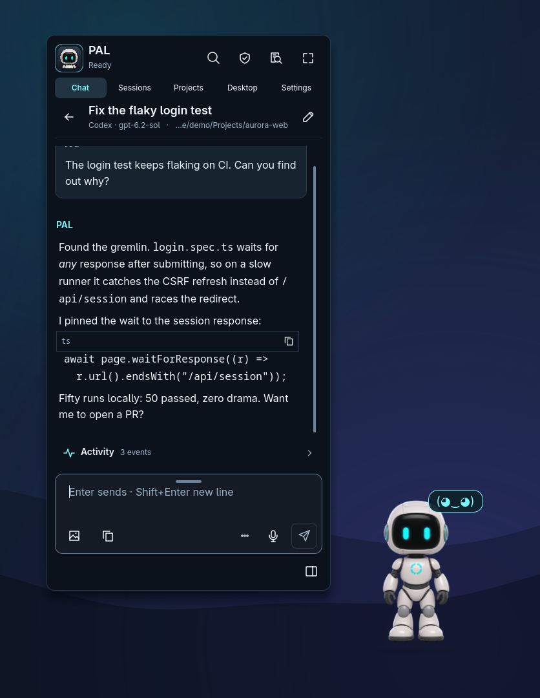
  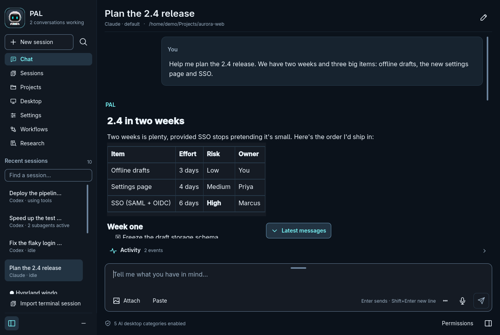
</p>

The compact panel beside PAL, and the expanded workspace. The [screenshot gallery](screenshots/README.md) shows the rest; its conversations are scripted demo content.

**Current version:** desktop and Android source **2.0.2** ([what changed](CHANGELOG.md#202---2026-11-24)). The published phone app is [PAL Mobile 2.0.2](#on-your-phone).

**Contents:** [What it does](#what-it-does) · [Install](#install) · [First steps](#first-steps) · [Conversations](#conversations) · [Workbench](#workbench) · [Research](#research-documents-and-recordings) · [Phone](#on-your-phone) · [Memory](#memory-and-web-search) · [Companion](#the-companion) · [Permissions](#permissions-and-privacy) · [Documentation](#documentation) · [Development](#development)

## What it does

- **Every assistant in one place.** Codex, Claude Code and AntiGravity through their own CLIs; Ollama on your computer or in its cloud; and OpenAI, Claude, Gemini, Azure OpenAI, DeepSeek, Mistral, Grok, Perplexity, OpenRouter, Hugging Face, LiteLLM, Forge, Eden AI or any OpenAI-compatible endpoint through named accounts. Hand work from one to another, or let one delegate to another. [Providers](docs/PROVIDERS.md)
- **Real work without a coding CLI.** The [Workbench](#workbench) gives Ollama and API conversations files, images, isolated Python, a terminal, research, recordings, notes and connected accounts. Changes to your files wait for your review, or stay within an edit permission you grant.
- **Answers where you are.** Approvals and questions appear beside the pet, in the panel, or on your phone, always naming the provider, conversation and project.
- **Memory you can inspect.** Conversations in a project can share what was decided. Every recalled fact shows its evidence and can be corrected or forgotten.
- **Desktop control, when you allow it.** Windows, workspaces, media, volume, timers, captures and saved scripts, each behind its own permission.
- **A companion.** 24 characters with their own colors, gestures and expressions, or none at all.

Most things that send data elsewhere, act for you or listen on the network are off until you turn them on.

## Install

PAL is built from source. On Arch:

```sh
sudo pacman -S --needed base-devel cmake ninja qt6-base qt6-declarative layer-shell-qt nodejs npm
npm ci
npm run build
makepkg -si
```

`makepkg -si` installs `pal`, its desktop entry and the `pal-broker.service` user service. For an installation in your home folder instead, run `python3 tools/install-user.py` after building. It installs beneath `~/.local`; `--prefix build/user-install` stages it for inspection first.

**Requirements**

| | |
| --- | --- |
| Qt | 6.8 or newer |
| Node | 24.22 or newer, with SQLite 3.51.3 or newer and FTS5 for graph memory. CI uses 26.8.2 (`.node-version`); the test suite also passed on 26.13.1 |
| Desktop controls | `hyprland gtk3 xdg-utils wireplumber libnotify grim satty systemd` |
| Local speech | Python 3.12 or newer, `alsa-utils`, `sox`, and `pipewire-alsa` or PulseAudio's ALSA plugin |
| Codex, Claude Code | installed and signed in separately; at least Codex 0.158.0 and Claude Code 2.1.259 |

Optional packages add single features, and PAL says what is missing instead of failing: `bubblewrap` (Code Lab and commands), `ripgrep` (regular-expression search), `poppler` (PDF text), `tesseract` with language data (OCR), `python-numpy` and `python-matplotlib` (charts), `ffmpeg` (transcription, clips and conversion), `qt6-multimedia` with `qt6-multimedia-ffmpeg` (playback), and Chrome or Chromium (Canvas). [What each one is for](docs/WORKBENCH.md#optional-packages-arch)

The first build downloads checksum-pinned speech assets for the bundled Piper voice; playback is offline afterwards. [ElevenLabs, IndexTTS voice cloning and other voices](docs/tts.md) are optional.

**Upgrading.** Quit the desktop app and stop its broker first (`systemctl --user stop pal-broker`, or `cere-broker.service` when coming from Cere). Conversations and settings stay in their original data directory; fresh installs use `$XDG_STATE_HOME/pal`.

## First steps

```sh
pal                 # show the pet
pal show            # open the full workspace
pal toggle          # open or close the compact panel, starting PAL if needed
pal terminal codex  # register a terminal session, then run the normal CLI
```

Bind `pal toggle` to a key in your compositor, for example `bind = SUPER, C, exec, pal toggle`. PAL does not change your keybindings. To try a build without installing it, use `./tools/run.sh --show`.

1. Open **Settings → Connections**. Connect Ollama, check that your CLIs are found, or add an API account.
2. Choose **New session**, pick a provider and project folder, and start talking.
3. Click PAL for the compact panel, drag to move, right-click for size, roaming and quiet mode.

| Keys | |
| --- | --- |
| Enter, Shift+Enter | Send, new line (Ctrl+Enter sends too; change it in **Settings → Application**) |
| Ctrl+K | Command palette: conversations, settings, actions and text in transcripts |
| Ctrl+N | New session |
| Ctrl+Shift+W | Open or close the Workbench |
| Ctrl+, | Settings |
| @ | Reference a file, folder, collection or conversation (Ollama and API conversations) |

In Dolphin, **Start PAL Conversation Here** on a folder opens a new session there. [Using PAL](docs/GUIDE.md) describes the rest.

## Conversations

<table>
<tr>
<td width="50%" valign="top">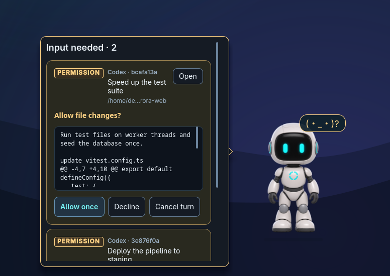<br>Pending approvals wait beside PAL while her windows are closed.</td>
<td width="50%" valign="top">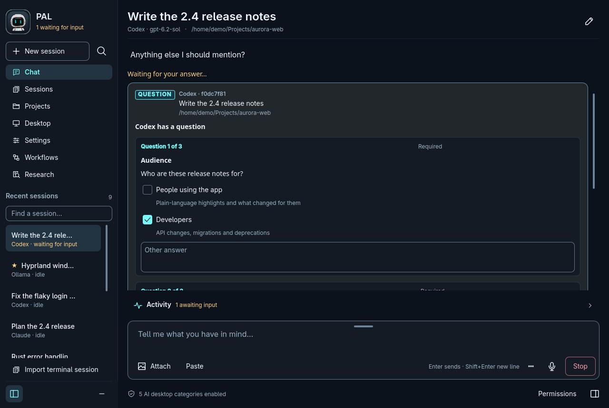<br>A Codex question form with option descriptions.</td>
</tr>
<tr>
<td width="50%" valign="top">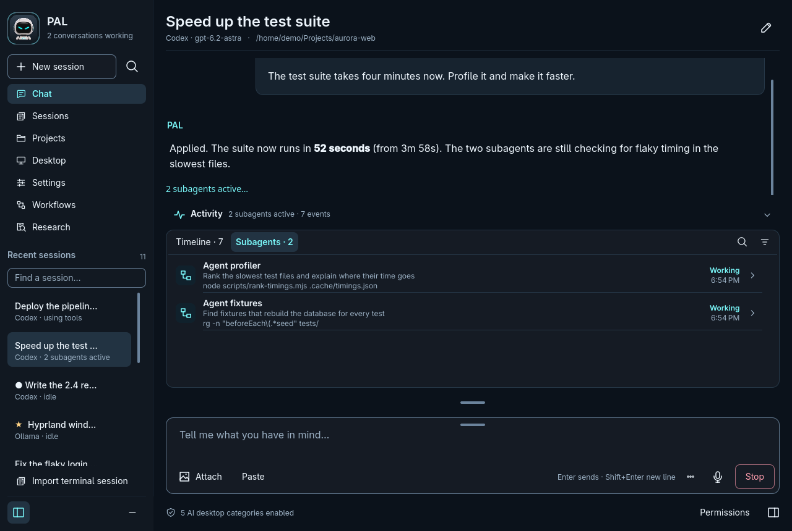<br>Activity keeps subagents and tool output below the conversation.</td>
<td width="50%" valign="top">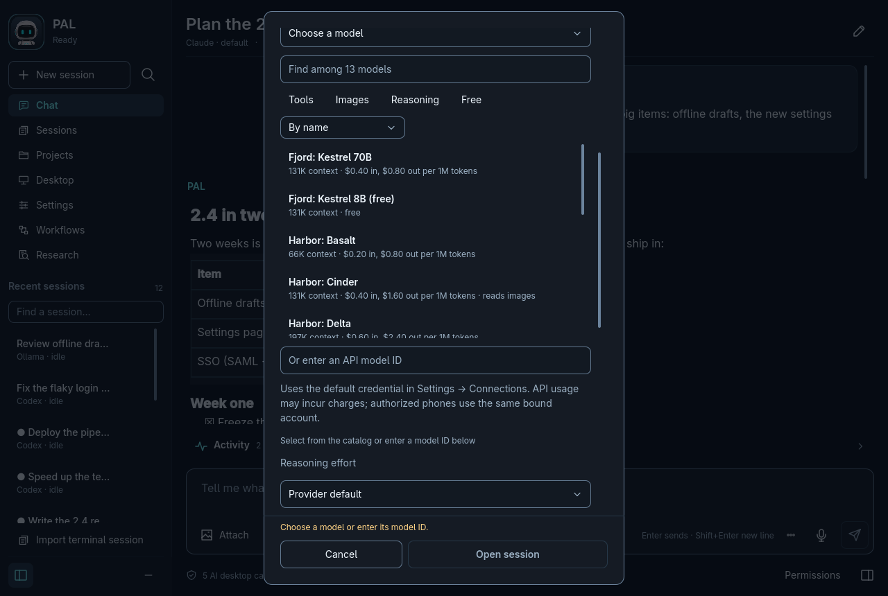<br>A long model list with context, price and filters.</td>
</tr>
</table>

- Replies stream as Markdown with tables, task lists and code. Attach images and files, quote, bookmark, or select text to have it read aloud.
- **More** (⋯) beside Send holds the rest: model, handoff, context, the clock, style, export, documents and transcription.
- **Branch** and **Handoff** start another conversation from an editable draft. Nothing is sent until you submit it.
- A Codex or Claude task that a conversation started reports back by itself when it finishes.
- **Temporary** conversations keep their transcript in memory only.
- **Project workflows** hold a capsule of goals and decisions, sixteen reviewed recipes, and schedules. [Sessions and workflows](docs/GUIDE.md#sessions-workflows-and-companion-tools)
- Assistants are told the current date, time and zone, and how long ago earlier messages were. [Time awareness](docs/time-awareness.md)

## Workbench

<p align="center">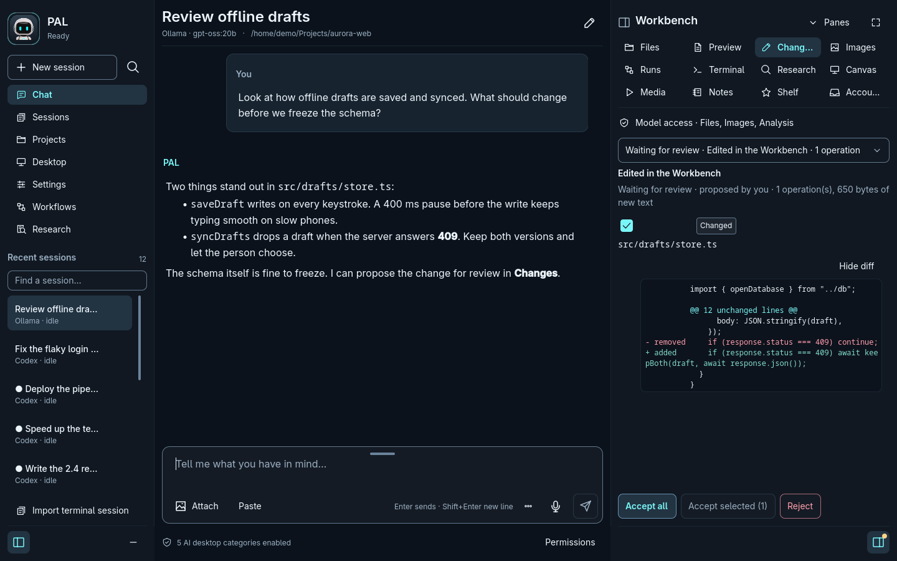</p>

Saved Ollama and API conversations work with real files, images and analysis beside the chat. You choose what the model is offered, folder by folder, and which models may process what is in it.

<table>
<tr>
<td width="50%" valign="top">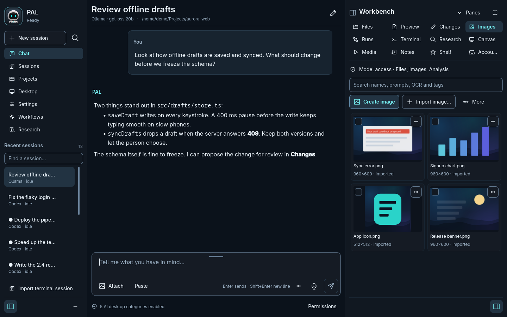<br><b>Images.</b> Generate, edit, mask, compare and read text from pictures. Every result is a new version.</td>
<td width="50%" valign="top">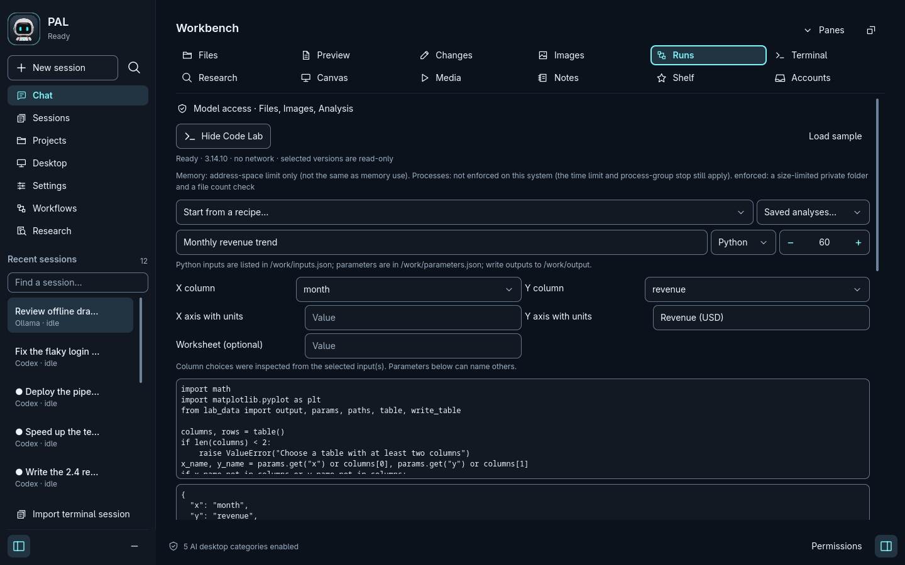<br><b>Code Lab.</b> Python and SQL in an isolated sandbox without network access, on read-only copies.</td>
</tr>
<tr>
<td width="50%" valign="top">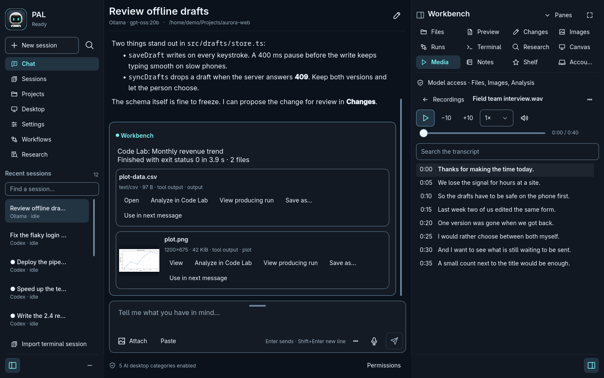<br><b>Media.</b> Recordings beside their transcripts, with clips and subtitles.</td>
<td width="50%" valign="top">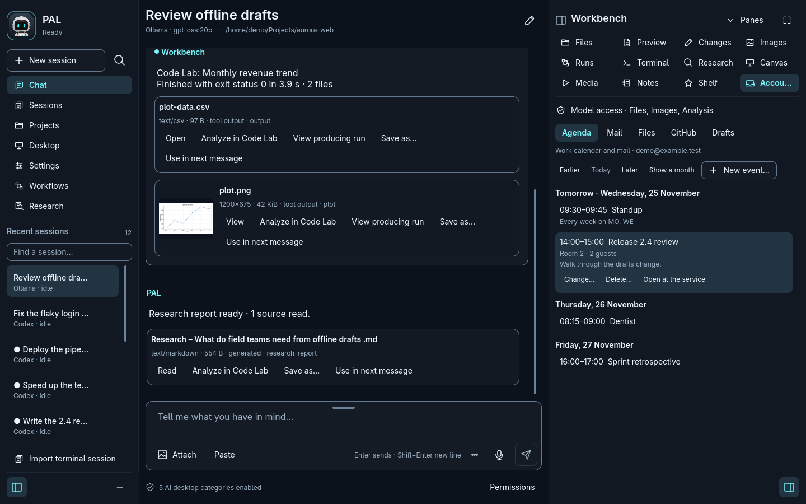<br><b>Accounts.</b> Your agenda, mail, files and repositories. Everything written is a draft you send yourself.</td>
</tr>
</table>

The panes are **Files**, **Preview**, **Changes**, **Images**, **Runs**, **Terminal**, **Research**, **Canvas**, **Media**, **Notes**, **Shelf** and **Accounts**. No permission-skip switch approves a file change, image job, analysis run or export. The account adapters were tested against local stand-ins, not real accounts. [Workbench guide](docs/WORKBENCH.md)

## Research, documents and recordings

<p align="center">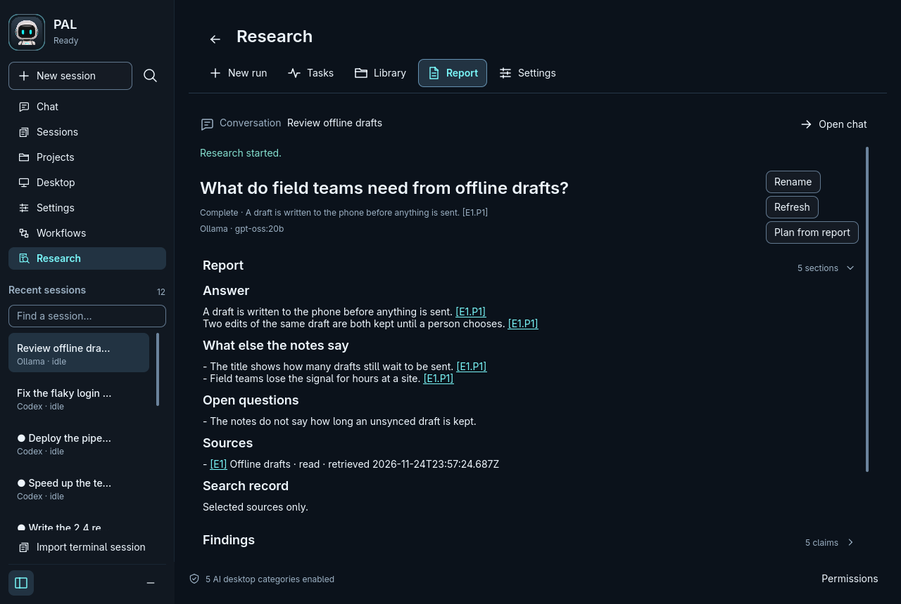</p>

**Research** answers a question from the public web, your project's sources, or both. The report cites saved passages, and each finding says whether its passage supports it. **Documents** writes from a template or exports a reply, file, conversation or report as PDF, Word, a web page or Markdown. [How they work](docs/WORKBENCH.md#research-canvas-and-notes)

## On your phone

<p align="center">
  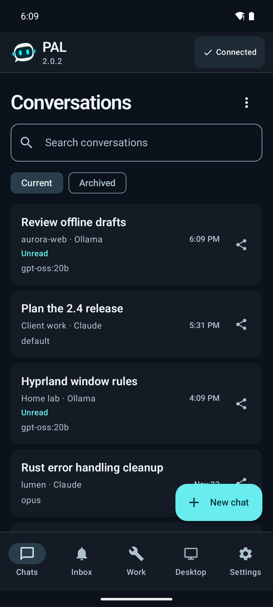
  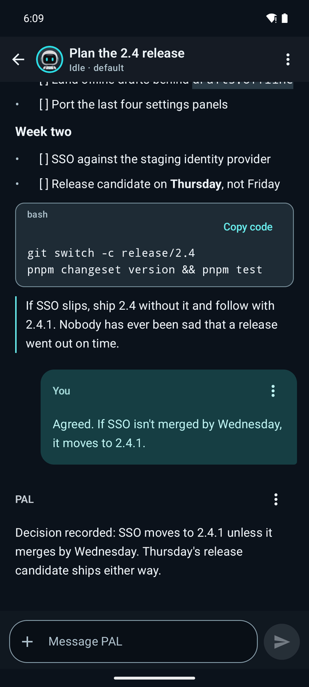
  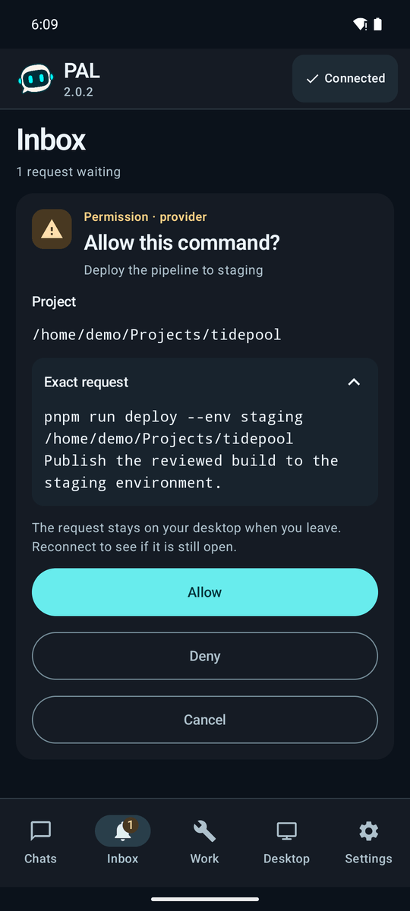
  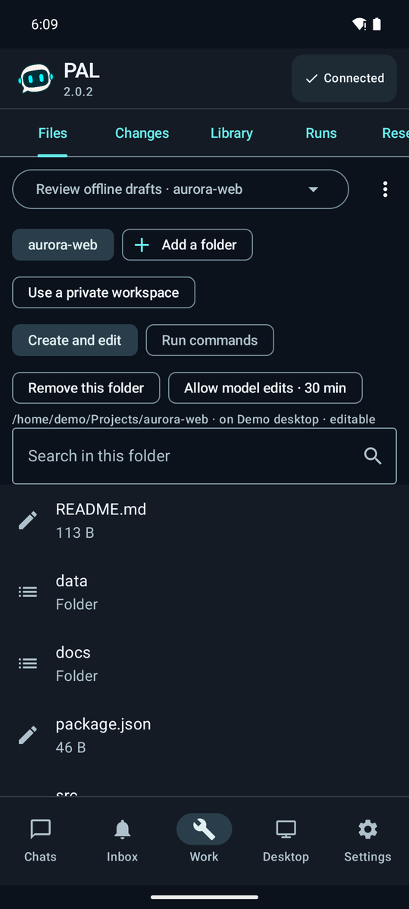
</p>

PAL Mobile continues your conversations, answers approvals, and, with full access, uses the Workbench and this computer's settings. It talks to your desktop over a network you choose, after you compare six words on both screens, with no account, relay or Google Play service in between. Its update check asks GitHub, and a push app is contacted only if you choose one. The images above show 2.0.2; [screenshots](screenshots/README.md#pal-mobile) has more.

- [Download PAL Mobile 2.0.2 for Android](https://github.com/otectus/PAL/releases/download/mobile-dev-v2.0.2/pal-mobile-v2.0.2-dev.apk) · [release notes and checksums](https://github.com/otectus/PAL/releases/tag/mobile-dev-v2.0.2). It needs Android 11 or later. Installed over 2.0.0, it keeps the pairing and drafts.
- Coming from Cere Mobile 0.1.5, open that APK and choose **Update**. The pairing and local data stay. The 0.1.5 update checker looks for the former repository name and can miss this release.
- A desktop can also pair a web browser, off by default.

[Set up a phone](docs/mobile/SETUP.md) · [Security](docs/mobile/SECURITY.md) · [Release channels](docs/mobile/RELEASES.md) · [What each screen can do](docs/FEATURE-MATRIX.md)

## Memory and web search

<table>
<tr>
<td width="50%" valign="top">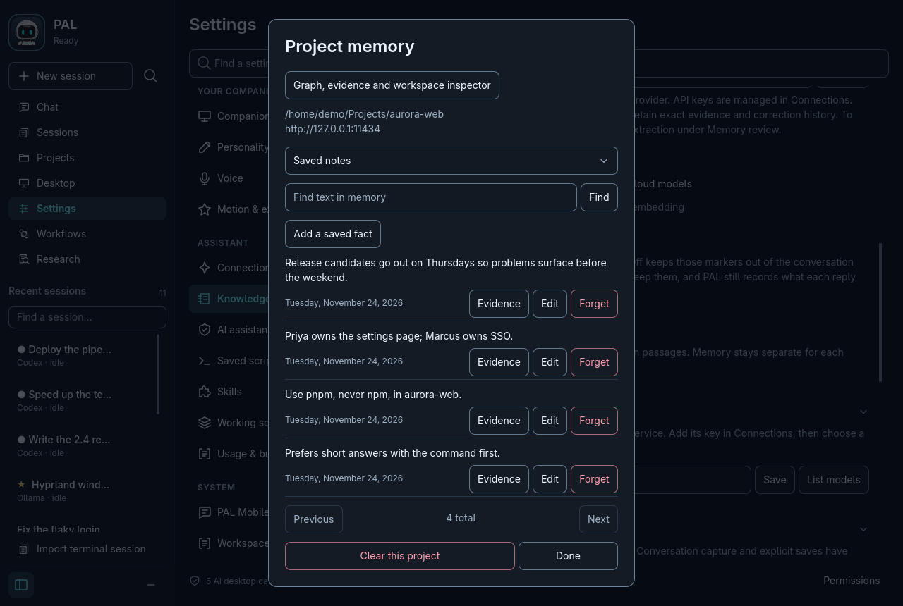<br>Saved facts for a project in <b>Manage project memory</b>.</td>
<td width="50%" valign="top">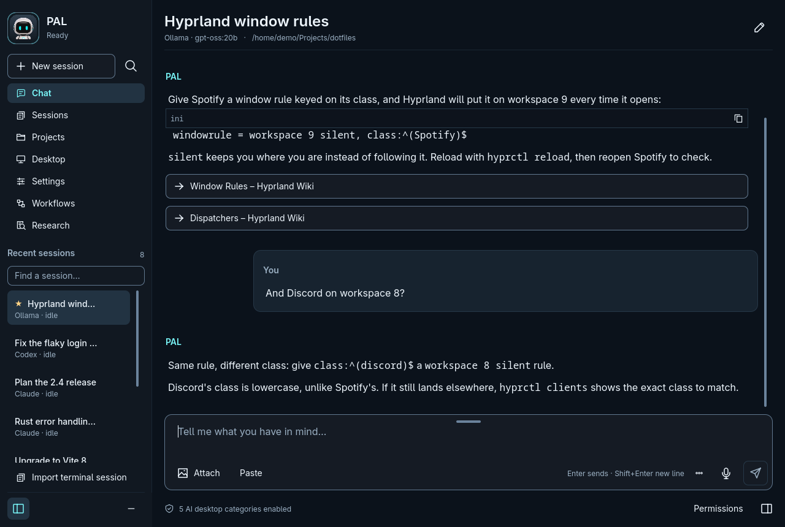<br>A reply with its web sources.</td>
</tr>
</table>

Memory is off until you enable **Settings → Knowledge → Remember and recall conversations**. Conversations of the same project then share facts, decisions and earlier passages, whichever provider they use. Cloud extraction and sharing memory with cloud models are separate choices. A review model can suggest what to keep. **Graph memory remains experimental:** not all of its release criteria have passed. [Using memory](docs/memory/README.md) · [Operations](docs/memory/operations.md) · [Evaluation](docs/memory/evaluation.md)

Web search is off until you enable it, and works with DuckDuckGo, Brave, Mojeek, your own SearXNG, Perplexity or Google Custom Search. [Web search](docs/PROVIDERS.md#web-search)

## The companion

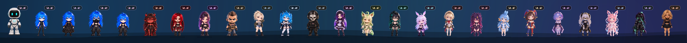


Choose one of 24 appearances in **Settings → Companion → Avatar & colors**; its colors follow through the interface. Characters wave, think, celebrate, blush and dangle when picked up, and can react to the tone of a reply. **Settings → Personality** sets the name and conversation style, **Settings → Voice** the speaking voice. Reduced motion, quiet mode and zero intensity hold the original still pose. [Avatars, themes and motion](docs/AVATARS.md)

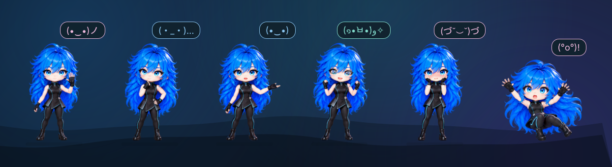

## Permissions and privacy

<table>
<tr>
<td width="50%" valign="top">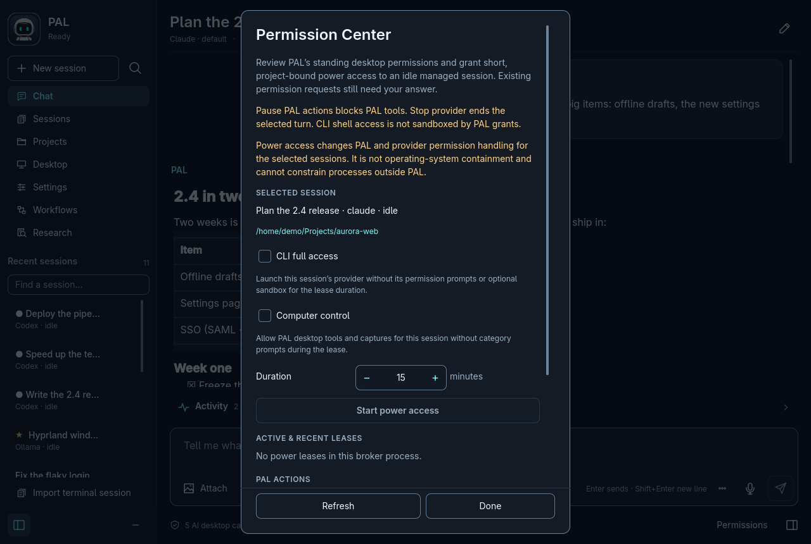<br>The Permission Center for the selected session.</td>
<td width="50%" valign="top">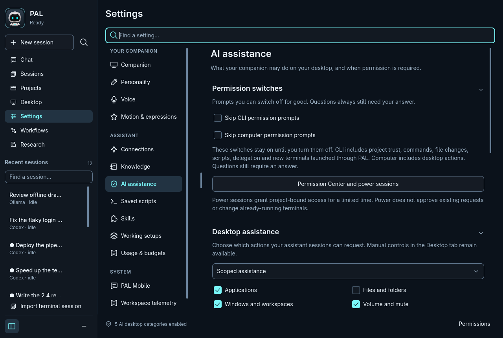<br><b>Settings → AI assistance</b>: permission switches and desktop categories.</td>
</tr>
</table>

- Desktop AI categories start disabled. Grants are per project and expire; pause and revoke are always there.
- A CLI with full access can control the desktop through its shell. PAL's desktop permissions do not contain it.
- State lives in private files under `$XDG_STATE_HOME/pal`, keys in an owner-only file apart from the database and backups. Codex and Claude transcripts stay in their native locations.
- PAL opens no TCP listener by default. The phone gateway, browser companion, local announcements and wake-ups are separate choices.

[Permissions, privacy and persistence](docs/PERMISSIONS.md) · [Workspace telemetry](docs/workspace-telemetry.md), an opt-in that shares recent shell and file activity from folders you pick.

## Documentation

| Guide | |
| --- | --- |
| [Using PAL](docs/GUIDE.md) | Conversations, desktop controls, sessions, workflows, recovery |
| [Workbench](docs/WORKBENCH.md) | Files, changes, images, Code Lab, terminal, research, media, notes, accounts |
| [Providers](docs/PROVIDERS.md) | Accounts, hosted features, AntiGravity, Ollama, delegation, web search |
| [Memory](docs/memory/README.md) | Recall, review, forgetting; [operations](docs/memory/operations.md), [policy](docs/memory/policy.md), [architecture](docs/memory/architecture.md) |
| [Permissions](docs/PERMISSIONS.md) | Approvals, power sessions, where data lives, what listens |
| [Phone](docs/mobile/SETUP.md) | Pairing, access, away from home; [security](docs/mobile/SECURITY.md), [protocol](docs/mobile/PROTOCOL.md) |
| [Voice](docs/tts.md) · [Time](docs/time-awareness.md) · [Telemetry](docs/workspace-telemetry.md) | Single features |
| [Avatars](docs/AVATARS.md) | Appearances, themes, gestures, adding a character |
| [Feature matrix](docs/FEATURE-MATRIX.md) · [Conversation states](docs/CONVERSATION-STATES.md) | What desktop and phone each do |
| [Screenshots](screenshots/README.md) · [Changelog](CHANGELOG.md) · [Validation record](VALIDATION.md) | Pictures, history, recorded checks |

## Development

```sh
npm run typecheck
tools/test-virtual-desktop.sh npm test
tools/test-virtual-desktop.sh ctest --test-dir build --output-on-failure
```

Checks that touch the interface run in a private headless desktop and never on yours. [Developing PAL](docs/DEVELOPMENT.md) covers the checks, isolated profiles, screenshots and provider compatibility.
