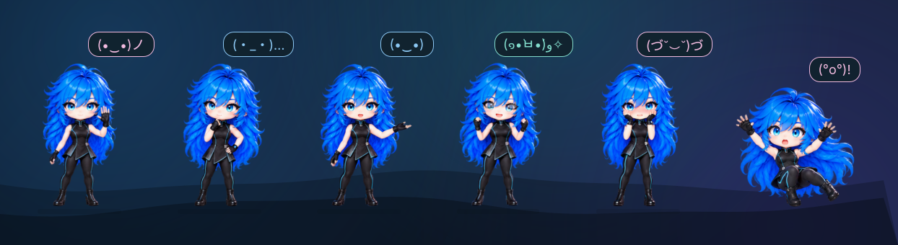
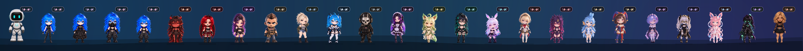

# Avatars, themes and motion

What the companions do, how moods and gestures are chosen, and how an avatar is added. Choose one in **Settings → Companion → Avatar & colors**; name and conversation style are in **Settings → Personality**.

## Gestures and motion

All 24 companions can wave, think, present, celebrate, blush on hover or click, and dangle when picked up. The default robot moves at its shoulders, elbows, wrists, hips and knees. Its cyan eyes follow the gesture. Standing gestures keep the feet planted, while the pickup loop lets the feet swing. The other companions use drawn pose sheets stored locally under `artwork/avatars/{id}/` with their generation prompts.



Animation follows Qt’s display animation clock. Each route contains 51 prepared frames, played at 60 Hz. Standing gestures hold their endpoint and return through the same frames. Hovering raises the hands into a gentle blush; clicking deepens the same sequence and opens or closes chat. The stronger reaction eases back to the hover pose while the pointer remains over the avatar. Dragging beyond the click threshold starts an alternating flail loop, with pendulum motion around the actual grab point and a softened shadow; releasing eases back into a standing pose. Interruptions reverse from the current frame before entering the latest requested gesture; an old gesture cannot jump back in after a newer request. Continuous breathing, restrained sway, attention and carrying/landing motion apply to the connected figure. Output-seam mirrors consume the primary avatar’s exact sample. Native GPU and software rendering use the same registered artwork, bounded lazy image caching and area-averaged textures for small desktop sizes.

The 76-clip catalog controls intent, priorities, timing and subtle movement. Nineteen clips select the six illustrated routes; the other clips use shared gaze, tilt, sway and other secondary movement rather than separate limb drawings. Hover and click reactions can play during ordinary task activity, while approvals, errors, disconnects and dragging take priority. Focus in a chat draft means listening; live provider activity distinguishes thinking, replies and tool work. Permissions and problems take priority, and confirmed completion can celebrate. Idle energy, intensity and mood still control automatic acting. Automatic blinks use registered closed-eye frames at rest and gesture endpoints, avoiding a neutral face being pasted over a moving pose. Winks close one visible eye; Witty’s fixed mint X and Rem’s covered eye remain unchanged. An automatic blink already in progress finishes smoothly when another eye animation starts. **Settings → Motion & expressions** includes previews, including **Timid blush · hands to cheeks**. Reduced motion, zero intensity and quiet mode use the original still pose. Hidden avatars stop their animation clocks. Speech is configured independently under **Settings → Voice**.

The compact panel and workspace headers use a dedicated twelve-frame head portrait, with neutral blinks, subtle head movement, pointer attention and a click-to-wink greeting. Other moods keep their expression because the atlas has only one neutral closed-eye portrait. Connection problems, permissions and task activity take priority. A small speech indicator follows actual voice playback. Quiet mode, reduced motion and zero intensity stop the portrait's animation; hidden and minimized windows stop its animation clock.

The portrait estimates the tone of PAL's current English replies locally, using weighted phrases, negation, contrast, recent clauses and expressive punctuation. It excludes tools, code and quotations, fades old replies and resets when you switch conversations or send a new message. Short holds smooth changes during streaming. Ambiguous, unsupported-language and over-12,000-character replies stay neutral. This is a best-guess expression, not a reliable interpretation of sarcasm or proof of task success. **Respond to conversational tone** disables it independently of activity expressions. The portrait and full body consume one settled QML mood source, shared between UI and overlay hosts through attention updates. The existing 650 ms hold for competing non-neutral moods remains; body reactions occur at most once every six seconds. Busy activity, permissions, problems, disconnects and dragging take precedence, and blocked reactions are discarded rather than queued. The tone toggle governs both reactions and idle tinting. Conservative opening-phrase matching remains for user support and as a fallback if the shared QML source is unavailable; it never overrides a valid neutral classification. Mood-weighted selection favors matching gestures among the remaining bag entries (3:1) without duplicating entries or inventing task success. Each avatar uses `assets/{id}-portraits.png`; its built-in imagegen prompt is kept with the local source art under `artwork/avatars/{id}/`.

Mood behavior is authored in `motions.json → bodyMoods`. Life multipliers below apply relative to the selected idle profile; unlisted channels stay unchanged. Preferred gestures bias order within the bag, not the total number of appearances across a complete bag.

| Mood | One-shot body reaction | Preferred idle gestures | Idle life multipliers |
| --- | --- | --- | --- |
| Neutral / ambiguous | None: no reliable cue | Normal pool | Unchanged |
| Curious | `curious` | `idleCurious`, `headTilt`, `surveyTurn` | Head ×1.15 |
| Thinking | `ponder` | `ponder`, `glassesAdjust` | Hands, sway ×0.8 |
| Happy | `buoyantBounce` | `buoyantBounce`, `heelRock`, `easySway` | Presence, sway, hands ×1.15 |
| Cheeky | `cheeky` | `idleSmug`, `explainSweep` | Head, hands ×1.1 |
| Skeptical | `skeptical` | `ponder`, `headTilt` | Sway, hands ×0.75 |
| Tender | `tender` | `idleSoft`, `attentiveRest`, `deepBreath` | Sway, hands ×0.65 |
| Concerned | `attentiveRest` | `attentiveRest`, `idleSoft`, `deepBreath` | Sway, hands ×0.55; head ×0.75 |
| Surprised | `doubleTake` | `lookAround`, `headTilt` | Head ×1.1 |
| Focused | `glassesAdjust` | `glassesAdjust`, `ponder`, `explainOpen` | Sway ×0.7; hands ×0.85 |
| Sleepy | `doze` | `deepBreath`, `idleSoft`, `attentiveRest` | Pace ×0.7; sway, head, hands ×0.6 |

Animation authoring separates reference registration, gesture intent and rendering:

- `assets/avatars.json` is the authoritative avatar manifest. Every entry supplies `id`, `label`, `description`, `themeLabel`, `portrait`, `rig`, `default`, `aliases`, `palette` and `authoring`. Exactly one entry is the default; aliases preserve old saved selections across upgrades. `palette` contains the shared color tokens; `authoring` contains reference crops, visible-eye registration, sheet ordering, portrait packing and any reviewed pose landmarks. `broker/avatars.ts` defines and validates the schema. The build checks every entry and its runtime assets. The broker, native startup, themes, Settings/command-palette search, mobile portraits and catalog-wide tests derive their entries from this file; there is no startup ID allowlist or second palette registry.
- To add an avatar, provide its reference and authored sheets, packed `assets/{id}-surface.png`, `assets/{id}-surface-rig.json` and `assets/{id}-portraits.png`, then add one conforming manifest entry. The three `tools/prepare-avatar-*.mjs` tools read its `authoring` settings there. Local source PNGs, prompts (including `carry-sheet-prompt.txt`) and generated registration remain under ignored `artwork/avatars/{id}/`; the former `artwork/avatars/sources.json` is no longer read. Missing local source images still cause source-pixel checks to skip; shipped atlas/frame checks do not need them. Do not treat those skips as source-art validation.
- The shared `assets/pal-rig.json` retains the motion channels and stance definitions. Each manifest-selected surface rig registers its neutral and closed-eye cells, gesture frames, endpoint blinks and route mappings without changing painted aspect ratios. Registration supports one visible eye when a fringe covers the other, as for Rem. The preparation tools share silhouette separation for uneven gesture and portrait grids.
- `assets/motions.json` owns clip priorities, timing, idle profiles, blink cadence and mood reactions. `qml/Motion.js` samples continuous acting; `qml/SurfaceMotion.js` handles frame travel, holds and interruption recovery. `qml/GesturePlayer.qml` combines them on one clock.
- `native/avatarpuppet.cpp` validates atlas geometry and lazily prepares the selected frame for GPU or software rendering. At startup the interface checks the catalog from each atlas's PNG header without decoding it; the build's asset checks decode every atlas. If the shown avatar's artwork then cannot be drawn, a full load confirms the failure before that avatar is set aside, and the next usable one is shown with a notice. The desktop hit region includes every gesture silhouette. Each avatar's local `artwork/avatars/{id}/registration.json` records the source position, scaling and foot anchor used by the preparation tools.

After authoring, run `tools/test-virtual-desktop.sh node --test tests/avatar-surface-motion.test.ts tests/avatar-animation.test.ts tests/assistant-identity.test.ts tests/avatar-settings.test.ts` and `tools/test-virtual-desktop.sh ctest --test-dir build -R '^(avatar-registration|motion|avatar|avatar-software|qml)$' --output-on-failure`. The asset checks verify original visible pixels, frame bounds, planted standing gestures, free carried feet and unclipped silhouettes across the illustrated avatars. `pal-ui-check connectedSurfacePoses` checks gesture playback, interruption, reduced motion and input regions at two scales. `pal-ui-check avatarPointerReactions` checks both desktop sizes and covers hover, stronger click, the drag threshold, carrying, release and urgent-state priority. Set `QTEST_FUNCTION_TIMEOUT=900000` for these full-catalog UI sweeps. Run acceptance checks through `tools/test-virtual-desktop.sh COMMAND [ARGS...]`. It creates a private headless Hyprland session with separate profile, sockets, session bus, network and process namespaces; physical input devices and the working desktop are inaccessible. Pointer acceptance uses the virtual session’s Wayland pointer protocol for compositor button grabs, motion and release. It never creates a system-wide mouse. The wrapper requires Bubblewrap, an xdg-shell v6-capable Cage parent, Hyprland and a GPU render node; `PAL_CAGE_BINARY`, `PAL_RENDER_NODE` and `PAL_VIRTUAL_EVIDENCE` configure local dependencies and evidence paths. See `VALIDATION.md` for the validated local setup. `PAL_POINTER_EVIDENCE_ROOT` optionally separates pointer captures from other runs. Review captures from the virtual desktop as well: passing numeric checks does not establish visual quality.

**Settings → Companion → Avatar & colors** selects the avatar and matching theme. **Settings → Personality** controls the assistant’s name and conversation style. **PAL** is the default name. **PAL (Default)** (`pal`) is the robot from [PAL.png](../reference/PAL.png). Its full-body image follows the desktop companion’s movement. The illustrated gesture sequences belong to the other 23 appearances. **PAL (Classic)** (`pal_classic`) keeps the fitted black outfit with cyan trim. **PAL (Punk)** (`pal_punk`) retains the former masked respirator artwork, **PAL (Gothic)** (`pal_gothic`) wears the black lace dress, and **PAL (Punk - No Mask)** (`pal_punk_unmasked`) wears the punk outfit without its mask. **Daemona** adds crimson skin, dark hair, horns and gothic clothing. **Jade** has scarlet hair, a black crown, feathered wings and a plaid skirt; **Nova** has violet-tipped dark hair, a half-up bun and purple jewelry. **Soap** has a brown mohawk, stubble, a tan tactical vest and navy clothing. **Brandy**, **Archy**, **Ghost**, **Violet**, **Leafy**, **Cachy** and **Usagi** are joined by **Cynthia**, **Genga**, **Kippy**, **Pomni**, **Rem**, **Sarah**, **Sylva** and **Witty**. Witty has dark spiked armor, a black high ponytail with violet highlights, a mint eye and fixed X mark, and a torn cape with glowing spades. The illustrated characters use their matching images in `reference/`, share the gesture system and have twelve expression portraits. Choose **Save avatar** in Companion to apply an appearance. In Personality, enter a name of up to 64 characters (blank restores PAL) and choose **Save changes** to save the name and conversation style. Appearance and labels update immediately across the desktop pet, motion preview and conversation portraits; the chosen name reaches managed providers on their next turn. Avatar, name, personality and speaking voice are independent, and changes persist across restarts. Unsaved drafts survive unrelated setting updates; conflicting edits from another window require discarding the local draft before saving.

Saving an avatar also applies its theme. The robot uses pearl and cyan. **PAL (Classic)**, **PAL (Punk)** and **PAL (Punk - No Mask)** use cool blue; **PAL (Gothic)** pairs blue with darker charcoal and lace-inspired violet accents; **Daemona** uses black, dark red and crimson; **Jade** uses black and vibrant reds; **Nova** uses black, violet and purple; **Soap** uses tan and muted navy. **Brandy** pairs olive and denim blue; **Archy** uses cyan and blue; **Ghost** uses bone and muted slate; **Violet** uses purple and lilac; **Leafy** uses green and cream; **Cachy** uses teal; **Usagi** uses lavender, pink and cyan. **Cynthia** uses ivory, gold and crimson; **Genga** uses plum and magenta; **Kippy** uses sky blue and orange; **Pomni** uses indigo, red and gold; **Rem** uses periwinkle and lilac; **Sarah** uses obsidian and gold; **Sylva** uses rose pink and sky blue; **Witty** pairs obsidian with mint green and violet. Colors follow the character throughout the compact panel, menus, conversation cards, portrait frames, desktop bubbles, mood badges, motion preview and window portrait. The tray icon always shows PAL Mobile’s white speech-bubble face with cyan eyes. The theme follows the saved avatar immediately and across restarts; unsaved selections leave the current theme in place. New artwork was generated with built-in imagegen; the selected source sheets and prompts are kept locally under `artwork/avatars/{id}/`, outside version control.




PAL uses a neutral voice by default. The Personality field starts empty. Enter and save a style to customize replies, or choose **Use neutral voice** and save to clear it. The selected name takes precedence over an old self-name in personality text without rewriting your saved text. Changes apply on the next turn in existing and new managed Codex, Claude, AntiGravity, Ollama and API conversations; running turns retain their current instructions. Personality and names do not change permissions or project instructions. External linked terminals retain their own configuration until handed to PAL. The application, integration names and window identifiers remain PAL.

## Rebuilding the artwork

The default robot’s neutral drawing and mechanical joint keyframes are tracked in `reference/pal-front.png` and `reference/pal-joints.json`. Run `node tools/prepare-avatar-poses.mjs pal` to rebuild its six routes and held blinks. Run `node tools/prepare-avatar-portraits.mjs pal` to rebuild the cyan display expressions.

The other avatars’ transparent extractions, eyelid edits, gesture sheets, portraits and built-in imagegen prompts are kept outside the repository. The preparation tools and the source-pixel check in `tests/avatar-surface-motion.test.ts` read them from `artwork/avatars/`; without that directory the check is skipped. Rebuild the deterministic runtime assets with Sharp (from `npm ci`) and OpenCV for offline interpolation:

```sh
c++ -O2 -std=c++17 tools/interpolate-avatar-poses.cpp -o build/interpolate-avatar-poses $(pkg-config --cflags opencv5) -lopencv_video -lopencv_imgcodecs -lopencv_imgproc -lopencv_core
node tools/prepare-avatar-references.mjs
node tools/prepare-avatar-poses.mjs build/interpolate-avatar-poses
node tools/prepare-avatar-portraits.mjs
```

On systems packaging OpenCV 4, use `opencv4` in the compile command. Interpolation is an offline authoring step, not a runtime dependency. Intermediate frames go under `build/avatar-frames/`. Optional `sheetLandmarks` in the local source registry supplies sixteen normalized eye positions per route, plus `closed` for authored closed-eye poses. Witty uses these to distinguish her visible eye from mint hair and the fixed X mark; closed blush artwork remains intact. Reviewed `heldEyes` ellipses locate eyelids in the final registered gesture frames; `heldEyeSource` can refine the neutral eyelid crop. A `closed` pose remains exact, and a null eye preserves an eye that is already shut or covered. `node tools/prepare-avatar-poses.mjs --blink-only` updates only those existing packed blink cells, preserving every open frame and rig. Run it through the virtual desktop wrapper and review the resulting eye crops. The retired sprite/cutout assets and their preparation tools have been removed. Desktop branding retains `assets/pal-emblem.png`; `tools/prepare-icons.mjs` generates launcher icons, and its prompt is kept with the source art.

Standing gestures register each complete drawing against the neutral head and sole anchors before interpolation, with one affine map shared by the torso, hips and legs. The pose baker tracks the head across the route, smooths sudden shifts between keys and matches material colors to the neutral drawing. Held eyelid landmarks anchor the smoothed path. Size correction preserves authored head tilt so long hair cannot fold where the head meets the body. Neither keyframes nor inbetweens paste neutral lower legs onto a differently sized torso. All avatars use connected-figure extraction to exclude sheet rules and stray pixels. Pickup keeps its suspended artwork and free feet. Interpolation blends temporal alpha independently of optical-flow confidence, so an old limb fades when its correspondence leaves the canvas. Portrait expressions reuse the neutral silhouette, hair and costume outside the face. Set the optional `authoring.portraitFace` center (`cx`, `cy`) and radii (`rx`, `ry`) in 256-pixel cell coordinates for characters whose ears or headwear shift the default face estimate. Portrait component packing adds transparent gutters; optional `portraitCoreThreshold` and `portraitCoreErode` settings separate touching labeling seeds while retaining the original painted pixels. With OpenCV available, CMake also builds `pal-avatar-interpolate` and the `avatar-registration` CTest regression; the former can replace `build/interpolate-avatar-poses` in the command above. Sarah's celebration sheet uses explicit eye landmarks to avoid mistaking gold ornamentation for an iris.
