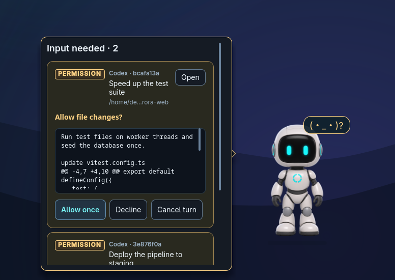
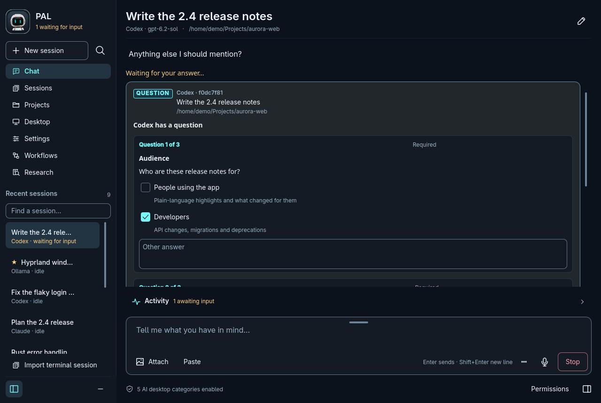
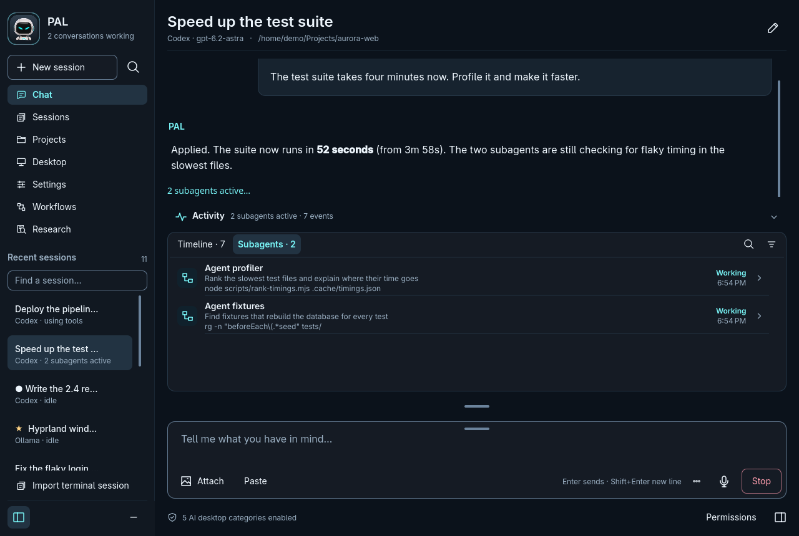
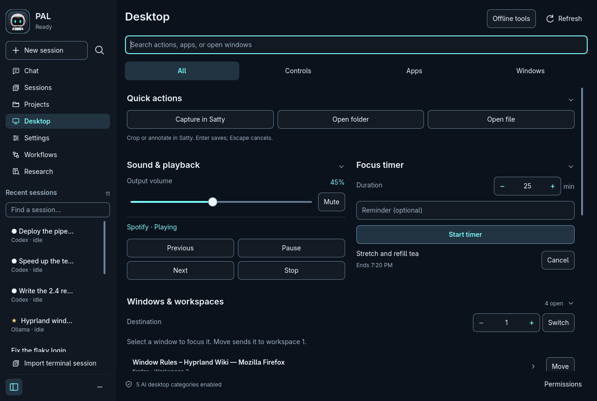
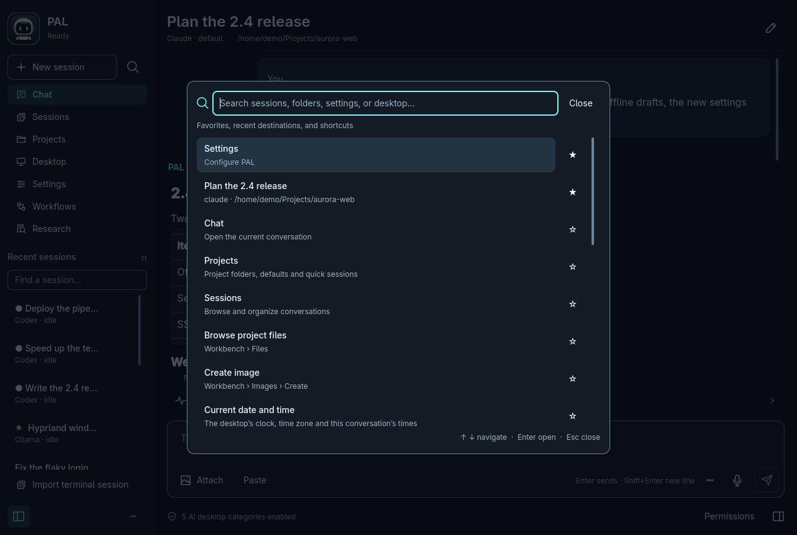
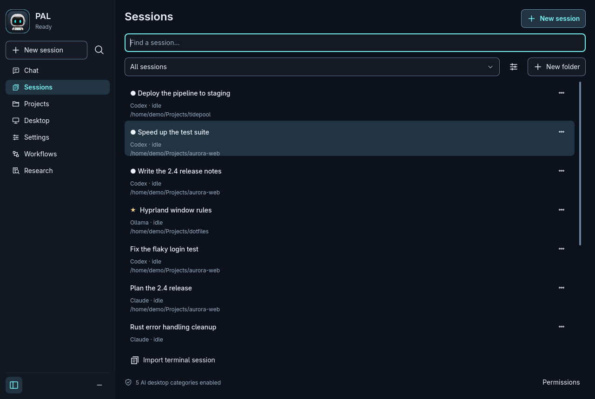
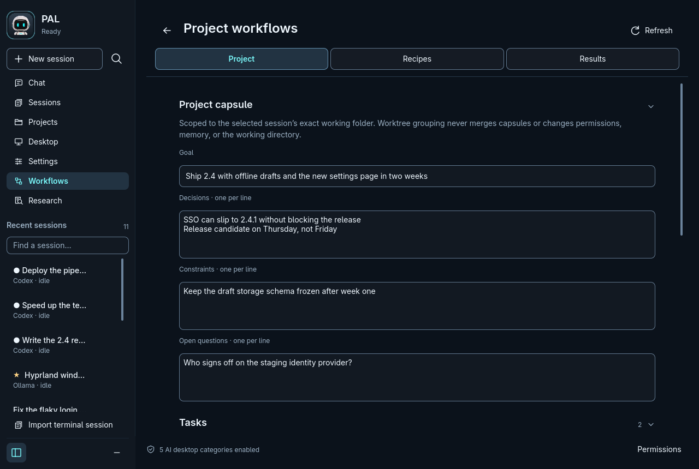
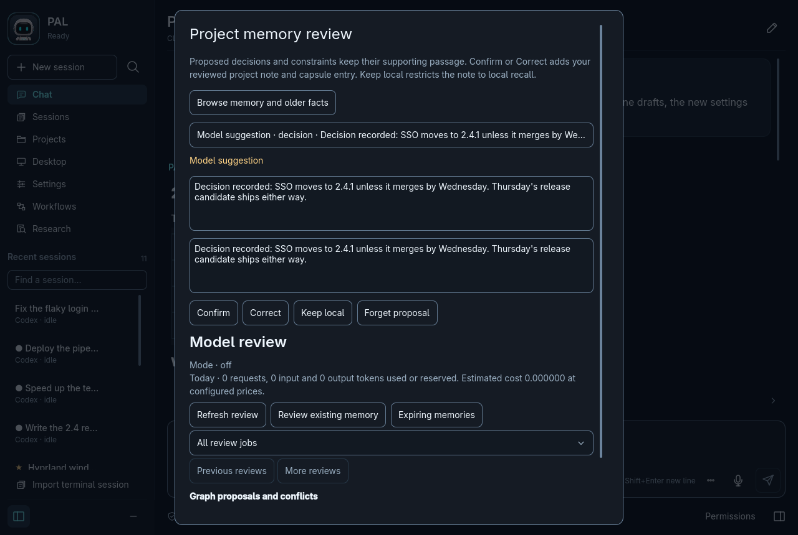

# Using PAL

How the desktop companion, conversations, projects and desktop tools behave. The [README](../README.md) is the overview; [Workbench](WORKBENCH.md), [providers](PROVIDERS.md), [memory](memory/README.md) and [permissions](PERMISSIONS.md) have their own guides.

## Installation details

The package lists the Workbench's optional programs as optional dependencies, except the browser; Tesseract also needs a language data package. The build compiles the Workbench's helpers with the toolchain from `base-devel`: `pal-workspacefs` opens files, `pal-terminal` runs terminals and `pal-document` prints documents as PDF.

The package installs `pal`, its desktop entry, and `pal-broker.service`. The installed UI starts the user service on demand, and starts it again if the broker stops while PAL is open. Login startup is opt-in in **Settings → Companion**. It adds an XDG autostart entry, which Hyprland runs only when the session processes autostart entries, for example through UWSM or `dex -a`. Removing the package preserves user data.

When upgrading, quit the previous desktop app and stop its running broker (`systemctl --user stop pal-broker`, or `cere-broker.service` when coming from Cere) before starting PAL. PAL opens existing conversations and settings in their original data directory. Fresh installs use `$XDG_STATE_HOME/pal`.

For a per-user installation after building, run `python3 tools/install-user.py`. This installs the application, menu entry, icon and user service beneath `~/.local`, and preserves an existing login-startup preference. When local build dependencies were used, it bundles LayerShellQt; base Qt and Node remain system dependencies. No project-folder launcher is needed. Use `--prefix build/user-install` to stage and inspect the installation first. Open **PAL** from your application menu, or run `~/.local/bin/pal --show`.

Speech uses bundled Piper and `en_US-amy-medium`. Two ONNX Runtime license texts are kept in `packaging/licenses/` because their upstream repository is no longer published. [Voices, `/tts-test` and Speech Dispatcher](tts.md)

Use your compositor’s configuration interface to bind `pal toggle` to a convenient shortcut. PAL does not replace your existing keybindings. The legacy Hyprland configuration equivalent is `bind = SUPER, C, exec, pal toggle`; newer Lua-based configurations use their own binding syntax.

## Conversations and the desktop

- Click PAL to open her compact panel; the message box is ready for typing as soon as it opens. Dragging suppresses the click. Right-click for size, roaming, quiet mode, and visibility. Always-on-top is enabled initially, including above fullscreen windows; disable it in **Settings → Companion** for normal floating behavior. With always-on-top disabled, the compact panel is a normal window that Hyprland floats beside her at its compact size.
- **More** (⋯) beside Send holds what a conversation needs less often: **Model**, **Handoff**, **Inbox**, **Memory review**, **Context**, bookmarks, the clock, style and posture, export, documents, transcription, and video or music. On short screens the conversation page scrolls rather than hiding controls, so every part of the panel stays reachable.
- Chat supports streaming replies, selectable CommonMark/GitHub Markdown (headings, emphasis, nested lists, task lists, tables, links, images and fenced/indented code), image attachments, Stop, and provider approvals. Tool activity stays in the expandable **Activity Panel** below the conversation; click its bar again to hide it. Enter sends (Ctrl+Enter works too) and Shift+Enter starts a new line; Ctrl+N creates a session; Ctrl+K opens the command palette; Ctrl+, opens Settings; Ctrl+Shift+W opens or closes the Workbench; Escape closes the Workbench when it is open. From another page it returns to the conversation; otherwise it closes the panel.
- Codex and Claude questions appear as dedicated forms with option descriptions, single or multiple selections, and written answers. Required answers are checked before submission. Desktop question drafts survive navigation and unrelated progress updates in the same UI process; private answers are masked and redacted from PAL's conversation history. Permission bypass never supplies an answer.
- **Activity** shows native subagents and delegated conversations, including their current task, progress, result, and interruption or failure. Active agent counts remain visible when the panel is closed. Parent conversations stay busy while tracked background work remains, and child replies stay in Activity. Claude Code's reply after its background work finishes belongs to the same turn. A delegated Codex or Claude task reports back by itself: when it finishes, its parent conversation shows a **Delegation update** card and takes an automatic turn to summarize the result (see [orchestration](PROVIDERS.md#ollama)). Stop includes active child work.
- Expand opens a workspace that remembers your layout. Drag the dividers to resize the sidebar, Workbench, message composer, Activity Panel and Settings navigation. A focused divider also responds to the arrow keys. Press Home or double-click to restore its default size. Collapse the sidebar or fold a long message when you want more reading room. Right-click a fenced code block to copy it, or press Shift+F10 with the text cursor inside the block. Selecting a session restores its draft. Moving between the compact panel and the workspace keeps the draft and its attachments, the cursor and selection, the **Search web** choice, the Activity Panel and the message you were reading, even though the two windows lay the conversation out at different widths. New output does not force scrolling while you read earlier messages, whether you scroll with the wheel, by dragging, or with the scrollbar.
- New sessions offer Codex, Claude Code, Ollama, AntiGravity and the dedicated API providers in the [provider guide](PROVIDERS.md) (see [AntiGravity and direct APIs](PROVIDERS.md#antigravity-and-direct-apis)). CLI model and effort dropdowns use each provider’s catalog; their default choices retain the CLI’s settings. Ollama offers its available chat models and a saved default. Ollama and the API providers can use a named account with its own endpoint, credential and model catalog. Ollama and API conversations can turn on the Workbench's **Files**, **Images** and **Analysis**. Tick **Save as my defaults** as you open a conversation and the next one you start from **New session** opens with the same provider, model, effort, desktop tools and temporary choice. Titles, folders and trust are chosen each time; projects keep their own defaults, and delegated, branched, imported and phone-started conversations never use these.
- When both PAL windows are closed or minimized, pending permissions appear in a speech bubble beside the visible pet, with the same response buttons and session labels as the workspace. Every request names its provider and session ID, the full session title and the project folder on separate lines, so a long title never hides which project is asking. The bubble remains available in quiet mode and disappears when requests end or a PAL window opens.
- Sessions creates managed conversations or imports completed CLI history. Confirm that the external session is stopped before resuming it. The terminal launcher only reports lifecycle and offers terminal navigation; it does not scrape or remotely type into the terminal.
- Handoff lets you choose another provider and creates an editable draft using recent conversation text. Nothing is sent until you review and submit it.
- Desktop groups controls into responsive cards, with category filters and search across actions, applications, and windows. It launches applications, opens files/folders, focuses or moves windows, changes workspaces, controls media and live output volume, opens captures in Satty, creates timers, and runs saved executables with explicit arguments. Long names have tooltips; every section remains reachable by scrolling in the compact panel.
- Capture in Satty opens the focused display in the crop/annotation editor. Enter saves the edited image and returns to PAL’s preview; Escape cancels. The temporary original is removed. An explicit sharing choice precedes giving an AI session the saved image.
- Media controls prefer Spotify when it is open, otherwise the playing MPRIS application. PAL displays the target and playback state, pins button commands to that target, and disables unavailable actions. Closing the target does not silently redirect an in-flight button press to a browser.

<table>
<tr>
<td width="50%" valign="top"> Pending approvals wait beside PAL while her windows are closed.</td>
<td width="50%" valign="top"> A Codex question form with option descriptions.</td>
</tr>
<tr>
<td width="50%" valign="top"> Activity keeps subagents and tool output below the conversation.</td>
<td width="50%" valign="top"> Desktop controls: quick actions, volume, media playback and timers.</td>
</tr>
</table>

## Roaming

Roaming starts disabled. When enabled, PAL slowly follows the mouse across your displays, easing into motion at up to 75 logical pixels per second and stopping short of the pointer. Small pointer movements do not make her shuffle constantly. Hovering or using her menu, opening either interface, a reply, completion or approval bubble beside her, dragging, fullscreen apps, task activity, hiding, quiet mode, and reduced motion pause following. The old roaming-area presets are replaced by following across the available screens.

## Sessions, workflows and companion tools

- **Ctrl+K** opens unified navigation for sessions, folders, projects, settings, saved actions, transcript matches, bookmarks, and decisions, with favorites and recent commands. **Ctrl+N** opens a conversation; **Ctrl+,** opens settings. Settings search and interface scaling work independently of pet size.
- **Settings** shows one category at a time, grouped under Your companion (Companion, Personality, Voice, Motion & expressions), Assistant (Connections, Knowledge, AI assistance, Saved scripts, Skills, Working setups, Usage & budgets) and System (PAL Mobile, Workspace telemetry, Application): in a rail beside wide pages, or a scrolling strip of chips on narrow ones. **Find a setting** searches individual settings; Enter or a result opens its category, scrolls to the control, focuses it and outlines it briefly. Escape clears the search first. **Ctrl+K** lists the same categories and settings, and Desktop's **Manage scripts** opens Saved scripts.
- **Sessions → New folder** creates an organizational folder. Rename it, move sessions between folders or back to Unfiled, pin, archive, and filter by working directory or unread status. Deleting a folder preserves its sessions. Folder membership never changes a project path, permissions, or memory scope. **Delete…** in a conversation's context menu (right-click or Shift+F10) removes it after confirmation, together with its transcript, draft, attachments, queued messages and workflow results. PAL refuses while the conversation is working, waiting for an approval or running a power session. Project memory is kept. Temporary conversations offer **Discard…** instead.
- The composer supports reviewed file/image attachments with previews and individual removal, drag-and-drop, explicit clipboard import, revisioned draft recovery, quote-to-reply, and message bookmarks. In Ollama and API conversations, type **@** to reference Workbench files, folders, conversation files, collections or other conversations in the project (see [Workbench](WORKBENCH.md)). Private attachment copies are removed once no draft, uncertain submission, or active turn needs them. **Context** shows where messages go, attachments, rough text usage, tools, skills and helper calls, the excerpts and pins a request was given, and recent memory evidence; native CLI history and filesystem access remain additional context PAL cannot fully measure. Pin a file, folder, collection or conversation there to have it read again for every message.
- **Time.** Each request PAL composes carries the current date, time and zone, and a message keeps its own date while it waits in a queue. Choose a fixed zone, or one for a single conversation, and read the clock from the command palette. [Time awareness](time-awareness.md)
- **Documents.** Write one from a template, or export a reply, a file, a conversation or a research report as PDF, Word, a web page or Markdown. The assistant can make one when asked.
- **Branch** creates a new conversation with selected, editable context. A separate Codex native-fork option requests an actual provider history fork and reports failure if unsupported; it never silently substitutes a text copy. Temporary conversations retain PAL transcript/drafts only in memory and exclude durable workflows, memory, and mobile access. They currently accept text only; external providers retain their own policies.
- **Project workflows** provides editable, revisioned capsules scoped to the exact project directory. Resuming creates an editable draft from the reviewed capsule. There are sixteen built-in recipes, all with typed inputs, pinned instructions, versioned definitions, exact previews, a one-turn limit and a 30–600 second deadline. A recipe draft is sent only when you send it, or when a schedule you created for it runs. Substantial edits remain in the chosen editor. Eight are Workbench recipes, which take a folder, file, conversation file or collection that you pick rather than type; a Workbench recipe's draft gets only the folders you referenced, with the permissions they already have. The Workbench recipes are:
  - Explain this project
  - Review configuration change
  - Folder cleanup plan
  - Document briefing
  - Image asset kit
  - Screenshot to issue report
  - Data to report
  - Release materials
- The result hub separates provider completion from verification, links observed artifacts and transcript evidence, and can run an explicitly reviewed saved check in the result’s project. Only its observed exit code establishes that check’s pass/fail; it does not certify the whole task.
- **Memory review** proposes decisions or constraints from a message with its supporting passage and source role visible. Confirm, correct, keep local, or discard the proposal. Existing inspector correction/forgetting controls remain available inline, including **Why was this recalled?**.
- Push-to-talk records at most 60 seconds into a private temporary file. A local whisper.cpp executable and model or a speech server on this computer turns it into text; a hosted service does so only if you choose one in **Settings → Voice**. The transcript enters an editable review before the composer; there is no always-listening mode or automatic model download. OpenAI, Gemini and Grok conversations offer **Live voice** with a model that supports it. Speech supports selected-text playback, rate adjustment, and an optional brief reading that preserves the full written response.
- **Offline tools** provides notes, tasks, arithmetic, conversions, and pause/resume/repeating timers. Reviewed workspace routines use exact previews; undo is offered only for created timers. Focus, Gaming, and Presentation profiles combine visibility, speech, animation and ordinary notification preferences while retaining approval access. Home positions are per monitor; edge docking is explicit.
- **Health and recovery** (**Settings → Application → Maintenance**, beside **Backup and restore**) distinguishes provider/authentication/protocol/network, memory, and speech problems. It names desktop programs that are missing and the feature each one affects (**Unavailable until installed**; chat is not affected), and says when the previous stop could not confirm that everything PAL was running had finished. Diagnostics use an allowlist and must be previewed before export. Reviewed backups exclude by default credentials, device keys, active grants, executable actions, temporary conversations, and Workbench folder access, pending file changes and image or analysis runs. A backup with conversations can also hold their conversation files, with or without their contents; a restore checks every file's hash and tells you how many come back without their contents. Restore preserves the current forgetting registry, pauses tools, marks restored sessions interrupted, and never replays a turn. If forgetting records differ, old conversation, draft, attachment, file and notes payloads are omitted conservatively. Restoring keeps this computer's connections (saved connections included), API and image-backend keys, paired phones, voice profiles, personality and other preferences. It clears project grants until you resume tools. Conversations, drafts, notes and project capsules come from the backup only when it includes them; a backup without them restores a profile without conversations. Restoration stages a new profile and restarts the broker (through `pal-broker.service` when installed); the previous private profile, including its conversations, is retained.

<table>
<tr>
<td width="50%" valign="top"> The command palette (Ctrl+K) with favorites and recent destinations.</td>
<td width="50%" valign="top"> Sessions with filters, folders and pins.</td>
</tr>
<tr>
<td width="50%" valign="top"> A project capsule in Project workflows.</td>
<td width="50%" valign="top"> Memory review of a decision proposed from a reply.</td>
</tr>
</table>
