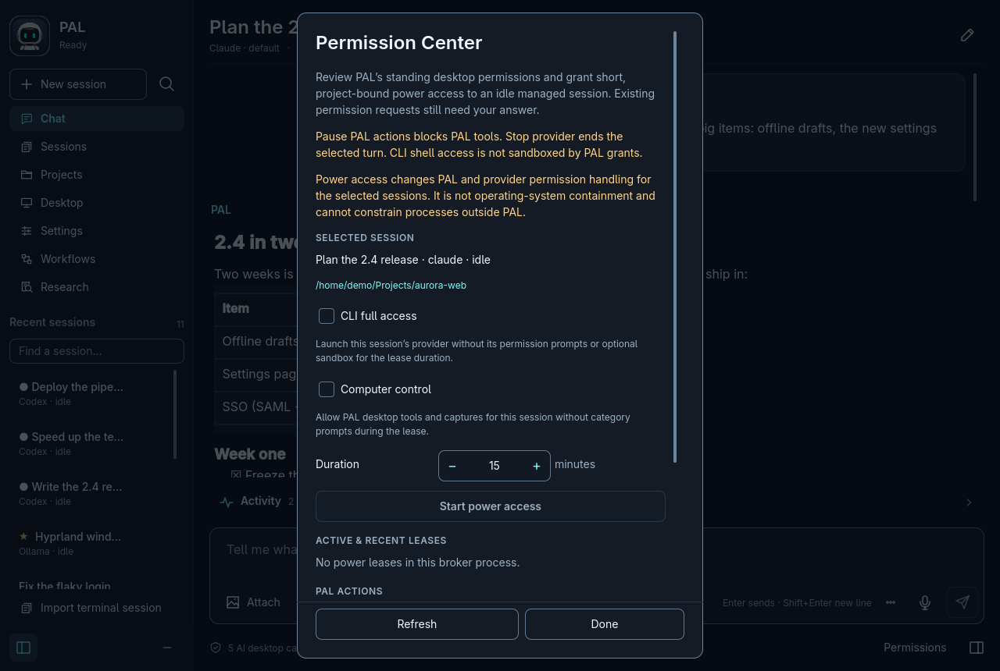
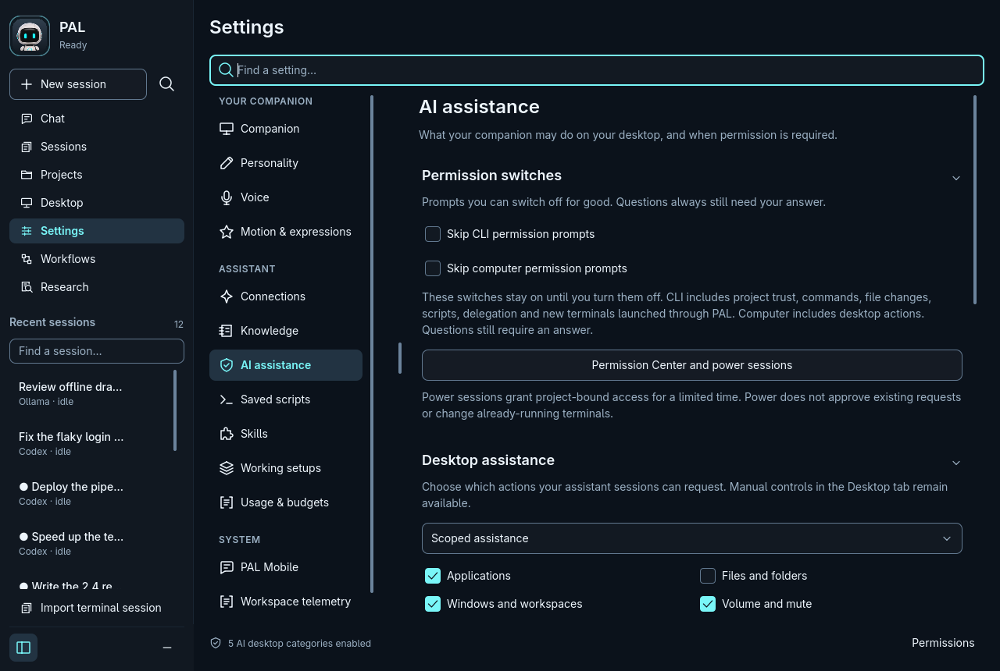

# Permissions, privacy and persistence

What PAL may do, who answers for it, where its data lives and what listens on the network. Phones have their own [security page](mobile/SECURITY.md).

## Permissions

Desktop AI categories start disabled. Scoped assistance enables chosen categories and asks before sensitive tools. Broad control is optional and requires project-specific, expiring grants. Pause and revoke remain available. PAL’s grants govern its own MCP tools; they do not sandbox unrelated shell access already granted to a CLI.

**Permissions** opens a single center for effective access, provider state, project grants, expiry, revocation, and separate controls for pausing PAL actions and stopping provider work. **Settings → AI assistance** also has two switches that stay on until you turn them off. **Skip CLI permission prompts** approves project trust, commands, file changes, scripts and delegation in managed conversations, and auto-approves CLI requests from paired phones that hold both `providers.execute` and `approvals.provider` (see [mobile security](mobile/SECURITY.md)). It also starts new `pal terminal` sessions with `--dangerously-bypass-approvals-and-sandbox` (Codex) or `--dangerously-skip-permissions` with the sandbox disabled (Claude Code). **Skip computer permission prompts** approves desktop actions. Questions always require an answer. Neither switch approves Workbench change reviews, image jobs, analysis runs, exports or vision-helper requests. Only the Workbench's own permissions skip those questions (see [Workbench](WORKBENCH.md)).

<table>
<tr>
<td width="50%" valign="top"> The Permission Center for the selected session.</td>
<td width="50%" valign="top"> <b>Settings → AI assistance</b>: permission switches and desktop categories.</td>
</tr>
</table>

**Power sessions** deliberately grant CLI full access, computer control, or both to selected idle, locally managed sessions in one canonical project directory. Leases last 1–120 minutes, remain visible, are never persisted, and must be renewed deliberately. Temporary, remote, and linked sessions cannot start one. Enabling power does not accept existing pending requests; questions always require answers. Ending or expiring a lease revokes new authority immediately and stops owned provider work, reporting confirmed or unconfirmed termination. Leases do not reach linked terminals, which keep their own permission configuration unless launched while **Skip CLI permission prompts** is on.

CLI full access can control the desktop through shell commands. PAL’s desktop permission categories do not contain unrestricted CLI processes. **Pause PAL actions** blocks PAL tools; **Stop provider** interrupts provider work. External provider or administrator restrictions still apply. Editing a saved executable invalidates review of its previous definition.

Markdown renders during streaming and when stored sessions reopen. Message Copy preserves the original Markdown, without memory citations while they are hidden; text selection copies the rendered text. Links open only on activation, and file links resolve against the session’s project directory. Tool output remains literal text. Wide tables can scroll horizontally.

Provider approvals remain separate from PAL’s desktop approvals. Codex file-change approvals show the proposed diff, network approvals name the destination, and approvals for input to a running command say so. Unknown provider requests fail closed with an explanation. MCP forms support strings, booleans, numbers, integers, and multiple selections from string lists, including optional fields. URL requests show the destination and require explicit browser opening and confirmation. Other complex forms are declined with an explanation. The adapters are checked against the [Codex app-server protocol](https://learn.chatgpt.com/docs/app-server) and [Claude Code headless mode](https://code.claude.com/docs/en/headless). They were last validated with Codex 0.162.1 and Claude Code 2.1.296 on October 12, 2026. On October 20, 2026 the no-cost checks `node tools/check-codex-protocol.ts` (every app-server method PAL uses is in the installed binary's schema) and `node tools/check-claude-protocol.ts` (PAL's ordinary and restricted print-mode flags and the stream-json handshake) passed for Codex 0.163.0 and Claude Code 2.1.303; they check names and handshakes, not turn behavior. On November 24, 2026 the same checks ran on Codex 0.171.0 and Claude Code 2.1.331: both passed. Codex 0.171.0 removed `currentTime/read`, a request it used to make of PAL; the check lists it as retired, and PAL still answers it for older versions. Each message carries the time either way ([time awareness](time-awareness.md)). PAL requires Codex 0.158.0 or newer and Claude Code 2.1.259 or newer, and reports an older CLI as needing an update. Authentication and billing remain with each CLI.

State is stored in `$XDG_STATE_HOME/pal/pal.sqlite` (normally `~/.local/state/pal`), using private filesystem permissions. It includes settings, drafts, conversation messages, recent action metadata, and timers. Screenshots live in the sibling `captures` directory. Workbench conversation files are stored by content hash under `artifacts/` in the state directory, and private conversation workspaces under `workspaces/`. Codex and Claude transcripts remain in their native locations. Ollama’s full conversation context, tool results, and explicitly shared images are stored in PAL’s private database. Enabled graph memory also publishes eligible projections to the configured local Neo4j and Qdrant services; selected cloud extraction uses Ollama Cloud.

PAL IPC uses a private Unix socket at `$XDG_RUNTIME_DIR/pal/broker.sock`; enabled Fish collection uses `$XDG_RUNTIME_DIR/pal-memory/memory.sock`. Connections require the same OS user. PAL opens no TCP listener by default. The optional Android companion gateway listens only on explicitly selected LAN/WireGuard addresses, for a paired phone or for the five minutes a pairing QR is shown (when it accepts only that offer's signed answer); pairing is confirmed locally by comparing six words. The optional browser companion has its own listener, on this computer only unless you choose addresses; announcing the gateway on the local network and wake-up hints are further options. All of them are off until you turn them on. See [mobile setup](mobile/SETUP.md) and [implementation limits](mobile/TESTING.md). Configured Ollama and memory dependencies use HTTP(S) or Bolt, with the packaged database ports restricted to loopback. MCP subprocesses receive session-scoped random capability tokens. A UI restart leaves broker work running. A broker restart marks incomplete turns interrupted and never silently replays them. Stopping the broker refuses new changes, lets running phone operations finish, then stops providers, workers, memory and speech within ten seconds; a stop that could not confirm all of that is reported in Health after the next start. If the broker stays connected but stops answering, the interface shows **PAL is not responding** after 15 seconds, ends the requests it was waiting on with an explanation instead of resending them, keeps your drafts, and recovers when the broker answers again. Restart the installed broker with `systemctl --user restart pal-broker` only when you intend to interrupt its active work.

For isolated development, set `PAL_STATE_DIR` and `PAL_RUNTIME_DIR`. Set `PAL_CODEX_BIN` or `PAL_CLAUDE_BIN` to an executable path when testing a different provider build. Managed conversations, provider detection, model catalogs and Codex history import all use that executable; `pal terminal` still runs the CLI found on `PATH`. Without an override, the broker looks on `PATH` and then in `~/.local/bin`, where both CLI installers put their launchers, and adds `~/.local/bin` to the `PATH` its provider processes inherit.
