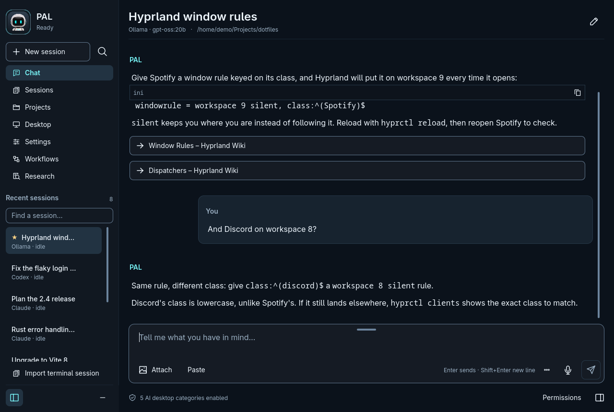

# Providers in PAL 2.0.2

Open **Settings → Connections**, choose the provider, add a named account, and enter its credentials. Test the connection and refresh its models. In **New conversation**, choose the provider, account and model. A custom model or Azure deployment ID can be entered for catalogs that do not list it. Use the conversation's model settings to change the account or its advanced options. Choose Grok (xAI) or Perplexity directly in either client.

| Provider | Account setup | Selection |
| --- | --- | --- |
| OpenAI | API key, with an organization and project if the key needs them | Responses model ID |
| Claude API | Anthropic key | Messages model ID |
| Google Gemini | Gemini API key, or a named Vertex account with Application Default Credentials and its project/location endpoint | Gemini model ID |
| Azure OpenAI | Named resource endpoint, deployment and API key or Entra identity | v1 or versioned deployment endpoint |
| DeepSeek | DeepSeek API key | Chat or Responses variant and model |
| Mistral | Mistral API key | Chat or Responses model. OCR uses a separate Workbench request |
| Grok (xAI) | xAI API key | Grok model. Web Search and X Search are independent choices |
| Perplexity | Perplexity API key | Choose **Quick answer** (fast), **Research** (high), another effort preset, or enter an explicit Agent model ID. Open the Research pane for a background job |
| OpenRouter | OpenRouter key | Qualified upstream model ID from its searchable list, allowed/preferred providers, fallback and retention settings |
| Hugging Face | HF token, router or managed inference endpoint | Router model or task-compatible inference model |
| LiteLLM | Gateway URL and its own key, or the local bridge and the downstream provider's key | Proxy model alias or bridge model |
| Forge | Operator-supplied endpoint and key | Deployment's advertised model or explicit ID |
| Eden AI | Eden key | V3 provider/model and routing settings |
| Ollama | Local server, reviewed remote host or direct cloud account | Native Ollama model |
| Compatible / local models | Server URL, optional bearer or approved API-key header, processing location and capability declarations | Server's model ID |

Named account keys stay in PAL's private credential store and apply to their reviewed endpoint. A missing key on one account does not inherit another account's key. Default accounts accept standard environment variables, including `OPENAI_API_KEY`, `ANTHROPIC_API_KEY`, `GEMINI_API_KEY`, `AZURE_OPENAI_API_KEY`, `DEEPSEEK_API_KEY`, `MISTRAL_API_KEY`, `XAI_API_KEY`, `PERPLEXITY_API_KEY`, `OPENROUTER_API_KEY`, `HF_TOKEN`, `LITELLM_API_KEY`, `FORGE_API_KEY`, `EDENAI_API_KEY` and `OLLAMA_API_KEY`. CLI sign-ins remain independent.

## Looking after accounts

- **Check.** **Check…** on an account looks in stages: what is set up, whether the service accepts the credential, and whether its models load. These cost nothing. What a service does not let PAL find out for free is shown as not known. Trying a model (a reply, streaming, a tool call, an image, a structured reply) sends short requests that can be billed, and only when you start it. For a compatible server you can keep what was found as its declaration.
- **Remove.** **Remove…** lists everything that depends on an account. Move its conversations and settings to another account of the same provider first. A conversation keeps its readable history and sends it to the new account with its next message. What only the old account could read is left behind. An account is removed once nothing uses it.
- **Choose a model.** **Browse…** beside a long model list searches and narrows it, and shows what the catalog states: context, price, what a model reads, and the day its provider stops serving it. For an OpenRouter model, **Who serves it** lists the upstream providers with their prices and lets you prefer some of them. That request is free and names only the model.
- **Setups and specialists** name the account they run on. A setup whose account is missing says so instead of using another one.

## Using the services

- **Research and search.** A Perplexity background request retains its provider job ID, status and sources. Reopen the conversation to inspect it. If the connection drops during submission before a handle returns, inspect the account before submitting again. In Search settings, Perplexity retrieves raw results. Grok Web/X Search, Claude web search and Gemini grounding run within a model request. Google Custom Search needs an existing account, API key and search-engine ID. Its published shutdown date is January 1, 2027. Choose another engine for new setups. [Google Custom Search overview](https://developers.google.com/custom-search/v1/overview)
- **Files and media.** Workbench ordinarily sends extracted content according to the artifact's processing policy. Uploading an original PDF is a separate action. Attach the resulting handle to a message on the same account. Remove the remote copy when finished or check its provider expiration. Deleting a conversation attempts to remove its remote originals. The local broker method `originalFiles.pendingCleanup` lists receipts for unresolved deletions. Retry with `originalFiles.remove` using the receipt’s session and handle IDs. Images uses the selected generation backend and can bind to a named provider account. Timed media jobs retain the model, prompt, source versions and provider handle. Their validated outputs become conversation files.
- **Voice.** In Voice settings choose transcription and speech output independently. Local transcription, Piper and IndexTTS stay available. Google Cloud Speech uses Cloud credentials. Gemini speech uses the Gemini model route. Azure Speech uses its resource key and region. Realtime conversations negotiate a separate live model and stream audio through the broker. Stop playback or interrupt from the active client.
- **Knowledge.** Bind embeddings separately from the conversation model. Voyage needs its own key for embeddings or reranking. Select an embedding model, dimensions and, where applicable, pooling. A changed embedding space needs a new index. Choose cloud processing explicitly before sending eligible memory. Jev/TypeSafe takes named structured questions and returns model probabilities or scores. A score cannot authorize an action.
- **Vector stores.** Qdrant is the existing default. Set `PAL_VECTOR_BACKEND` to `simple`, `chroma`, `elasticsearch`, `pinecone` or `redis` to select another projection. For a server, configure `PAL_VECTOR_URL` and the service credential in `PAL_VECTOR_API_KEY`. External servers require TLS and `PAL_VECTOR_CLOUD=1`. Chroma accepts `PAL_VECTOR_TENANT` and `PAL_VECTOR_DATABASE`. Set `PAL_VECTOR_NAMESPACE` to isolate PAL's projection. Redis requires the Search vector commands. The simple store uses SQLite under PAL's memory directory.
- **Mobile.** An owner can manage the desktop's accounts through the paired broker. For a limited device, grant the project and the specific account in **Settings → PAL Mobile**. Updating an account or its credential can require reviewing the grant again. A conversation can remain readable even when the device cannot send.

When the OpenAI or Claude account offers computer use, enable **Reviewed desktop actions** and the conversation's desktop tools. PAL shows the proposed input, asks before using the display, and previews each screenshot before sharing it. Clicking, pointer movement, text entry and individual Enter, Escape, Tab and Backspace keys use the existing Wayland desktop input path. The remote display must remain available and keep the same geometry.

## Hosted files, speech and media

- **PDFs and inference.** In **Workbench → Images**, choose a file and open **Provider actions…**; on the phone, choose the file in **Work → Library**. A saved OpenAI, Anthropic, Gemini Developer or xAI conversation can upload a PDF, attach the reviewed provider copy to a message, or delete it. For Mistral OCR or Hugging Face tasks, choose a named account and approve the displayed input. Results appear as conversation artifacts.
- **Grok collections.** A Grok API key works for inference and original files. Add a separate xAI Management key to the same named account to create collections, manage documents and attach a collection. Turn on collection search in the conversation options. [xAI collections and approvals](providers/xai-collections.md)
- **OpenAI Responses.** To search existing account data, enter the vector-store IDs in the conversation options. Hosted code runs in a provider container. Use the reply JSON Schema field to request a structured final response.
- **Audio files.** From a saved conversation, select a Workbench WAV, permit cloud processing and choose a transcription service. Google Cloud long recordings require an existing, authorized `gs://` object containing the same audio. OpenAI Whisper supports word and segment timestamps. Mistral Voxtral supports segment timestamps. For Gemini two-speaker synthesis, configure two distinct speaker names and voices and write each turn on its own line as `Speaker: words`. [Google Cloud asynchronous recognition](https://cloud.google.com/speech-to-text/docs/async-recognize) · [Mistral file transcription](https://docs.mistral.ai/studio/audio/speech-to-text/transcribe-files) · [Mistral speech generation](https://docs.mistral.ai/studio/audio/text-to-speech/generate-speech)
- **Azure and OpenRouter.** Select a named Azure OpenAI v1 deployment for realtime, speech, or images. The image model field takes its deployment name. An OpenRouter voice or image model takes the full upstream slug. The image service supports a reference image when the selected upstream model accepts one. [Azure realtime](https://learn.microsoft.com/en-us/azure/foundry/openai/how-to/realtime-audio-websockets) · [Azure images](https://learn.microsoft.com/en-us/azure/foundry/reference/rest/images-create-image) · [OpenRouter images](https://openrouter.ai/blog/tutorials/image-generation/) · [OpenRouter speech](https://openrouter.ai/blog/announcements/announcing-audio-apis/)
- **Claude.** Web search, web page reading and code execution run at Anthropic when you turn them on in the conversation options; each step is listed under the reply. PAL asks each Claude generation only for what it takes: a thinking budget and a temperature where they are accepted, a reasoning effort or **Think before answering** on the models that decide by themselves. Current models read their reasoning back only behind exactly the text it was made with. When something before it changed, PAL leaves that reasoning out and keeps the text and tool results. Prompt caching is optional.
- **Gemini.** Google Search, reading the web pages you name, and code execution can be turned on together. Gemini 3 and later run them beside PAL's tools. Earlier models accept one or the other, and PAL says so before sending.
- **Files a provider's code makes** are kept with the conversation: from Claude's and OpenAI's containers and as Gemini's figures, at most 16 files of a reply, 32 MiB each and 64 MiB together. They are not kept in a temporary conversation.

## The LiteLLM bridge

A LiteLLM account of the kind **Managed local bridge** runs LiteLLM on this computer, one process for each account, with only that account's credential. Model names are LiteLLM's own, such as `anthropic/claude-sonnet-5`.

Open **Bridge…** on the account. PAL can keep LiteLLM in a folder of its own (`$XDG_DATA_HOME/pal/litellm`, normally `~/.local/share/pal/litellm`): it downloads the versions recorded in `tools/litellm-lock.txt` from PyPI, about 80 MB, and every file has to match its recorded hash. This needs Python 3.11 to 3.14 on 64-bit Linux. System Python is not changed, and **Remove…** deletes the folder again. `PAL_LITELLM_PYTHON` names an environment of your own and comes first; without either, the system's Python is used if it has LiteLLM. An environment of your own needs LiteLLM's `mcp` part before models can use tools (`pip install 'litellm[mcp]'`).

Replies stream, tools keep their calls and results together, and reasoning that a provider needs back is kept for the account that made it. **Start and test** loads LiteLLM without sending anything. PAL starts LiteLLM with its own price list, so it does not fetch one.

## AntiGravity and direct APIs

**New session** includes named Grok (xAI), Perplexity, Azure OpenAI, DeepSeek, Mistral, OpenRouter, Hugging Face, LiteLLM, Forge and Eden AI accounts alongside OpenAI, Claude API, Gemini, local endpoints and CLI providers. See the table above for what each needs. They also appear in reviewed handoffs and branches. A paired phone can start and continue the API conversations once it holds `providers.api` and that provider's grant (see [mobile setup](mobile/SETUP.md#manage-access)); its requests use this computer's keys and may be billed. AntiGravity turns start only on the desktop, because its headless mode cannot prove restricted execution; the phone can still read those conversations.

- **AntiGravity:** install the `agy` CLI and sign in interactively once. PAL discovers models with `agy models`, streams replies and tool activity, and resumes the conversation by its own ID. `PAL_ANTIGRAVITY_BIN` overrides the executable. Headless actions requiring approval are soft-denied by the CLI unless allowed in its settings or PAL's CLI permission bypass is enabled. PAL does not change global AntiGravity configuration. Text attachments are supported; image input and interactive permission questions are unavailable in this adapter.
  Model IDs ending in an effort, such as `gemini-4-carbon-high`, already select that effort. Use **Provider default** or the matching effort under **Model**; conflicting saved selections are rejected before dispatch. Provider failures include the CLI's error details.
- **API providers:** add a key in **Settings → Connections**, then connect to load the account's models. Select a model or enter an explicit model ID when creating a session. Standard broker environment variables also work: `OPENAI_API_KEY`, `ANTHROPIC_API_KEY`, and `GEMINI_API_KEY` (or `GOOGLE_API_KEY`). Saved keys take precedence; removing one restores any environment key. Keys are stored in an owner-only file under PAL's state directory, separate from SQLite, snapshots and reviewed backups. Replacing or removing a key stops its active API turns. API usage is billed by the provider, separately from chat subscriptions.
- **Compatible endpoint:** **Settings → Connections** also takes one OpenAI-compatible chat endpoint: a base URL such as `http://127.0.0.1:1234/v1`, an optional label, and a key unless you clear **Needs a key**. Declare what it supports (tool calling, image input, streaming replies, token usage, context and output limits) and where it processes requests (this computer, your own server, a cloud service, or not sure); PAL sends only what you declare and does not verify it. That processing location decides which Workbench files and images may be sent to it. The key is kept for that endpoint's origin and is never sent to another one.
- **Saved connections:** **Settings → Connections → Saved connections** keeps additional provider accounts and endpoints under names; choose one in **New session**. A conversation stays on the connection it was created on. Moving it to another connection asks you to confirm the new destination. Keys are saved per endpoint address, never in settings. The Ollama and compatible-endpoint settings above remain the defaults for new conversations.
- APIs support streaming, local conversation history, image/text attachments, optional desktop tools and Codex/Claude delegation, web search, and shared memory under the existing cloud-sharing setting. Tool availability also depends on the selected model. Requests use each provider's native API and do not follow redirects or automatically retry ambiguous failures. OpenAI responses use `store:false` unless you turn storing on. PAL keeps a bounded working context; API models without advertised context limits use a conservative 32,768-token budget. Claude API requests ask for the model's advertised output limit, or 4,096 tokens when the catalog lists none, and for nothing a Claude generation does not take. A reply that reaches a model's output limit is kept, marked as stopped there and kept in the model's history, so you can ask PAL to continue. Choose a reasoning effort where the model offers one; otherwise the provider's default applies.

API and Ollama requests automatically retry HTTP **429, 500, 502, 503 and 504** up to three times, waiting 1, 2 and 4 seconds plus up to 25% random jitter. `Retry-After` is honored within the request deadline and a 60-second maximum wait; a longer server requirement fails without retrying early. Other statuses, including 400/401/403/404, fail immediately. Transport failures with uncertain outcomes and streams that have already started are never replayed. **Stop** cancels pending waits. Broker retry logs contain the status, retry count and delay; cloud API conversations also show retry progress in activity. The reusable `withHttpRetry` wrapper lives in `broker/http-retry.ts`.

Use **More › Model** beside Send to choose a model for your next message. This works within the current provider for Codex, Claude Code, AntiGravity, the API providers (including a compatible endpoint), and Ollama. **Browse…** searches and narrows a long list, with each model's context, price and inputs as its provider states them. Wait for the current response or press **Stop** first. The conversation, draft, attachments and CLI conversation ID stay in place; other sessions and defaults are unaffected. CLI reasoning options follow the selected model. API conversations also accept a custom model ID when the catalog is unavailable; changing models keeps readable history and recorded tool results while discarding model-specific reasoning/signatures from the working context. The new API model must support the images and tools you use. For Ollama and API conversations, the same dialog has per-conversation options: **Temperature**, **Maximum reply**, and for Ollama **Context window** and **Keep loaded**. Empty fields keep the model's defaults, and PAL sends only the options you set. A phone with full access changes the model of an idle managed conversation; one with limited access does so in conversations it started with a provider it may run: Ollama, Codex, Claude Code (with restricted mode available) and the API providers it is granted.

Protocol references: [AntiGravity headless mode](https://www.antigravity.google/docs/cli/headless/), [OpenAI Responses streaming](https://developers.openai.com/api/docs/guides/streaming-responses), [Claude Messages streaming](https://platform.claude.com/docs/en/build-with-claude/streaming), and [Google GenerateContent](https://ai.google.dev/api/generate-content). AntiGravity receives recalled memory context when cloud sharing is enabled; PAL's automatic MCP tool installation remains specific to Codex and Claude Code.

## Ollama

Run an Ollama server, then open **Settings → Connections**. The default address is `http://127.0.0.1:11434`; **Connect** accepts another HTTP(S) server or reverse-proxy base URL. **Refresh** reloads its chat models. Choose a **Default model for new conversations**, or select a model when opening each session. **Manage local models…** downloads, loads, unloads and deletes models on that server when you ask; PAL never does so by itself. Embedding-only models are excluded and cloud-backed models are labeled **Cloud**. Cloud authentication stays with your Ollama server.

Choose **Ollama** in a new session for streaming conversation. The project folder is optional in conversation mode. **More › Model** changes an idle conversation’s model or enables assistance; existing context is retained. Defaults affect new sessions, and each session keeps its server address even if the connection setting changes. Image-capable models accept explicitly attached PNG, JPEG and WebP files (10 MB each, 20 MB combined, up to four). Thinking uses the model’s defaults and is retained in provider context without cluttering the transcript.

For orchestration, select a model marked **Tools**, enable **desktop tools and delegation**, and trust the project folder. Under **Settings → AI assistance**, enable the categories you want:

- **Provider orchestration** lets tool-enabled Ollama and API conversations start Codex or Claude tasks in the same project, send follow-ups, wait for and read results, and stop its delegated sessions. Unless a project power session grants CLI access, each task or follow-up asks you to review the exact prompt and provider first, including under Broad control. Delegated sessions appear in Sessions and retain their provider’s own approvals. Each conversation can manage only sessions it created.
- **Saved scripts** lets it list and run explicitly configured executables with their saved arguments, including other CLIs. Execution follows the same approval and grant rules as PAL’s existing script controls.
- **Tool servers (MCP)**, configured on the same page, add tools to tool-enabled Ollama and API conversations. Each server is either a program PAL starts (stdio) or a Streamable HTTP address. Every call asks first unless you allowed that tool, and a server's own hints grant nothing. Internet servers need HTTPS and public addresses; plain HTTP is only for this computer or a network you mark as local. An optional `BEARER_TOKEN` secret goes only to the server's own address, never across a redirect. Enabled HTTP servers offer **Sign in…** where the server supports OAuth. **Resources…** and **Prompts…** let you browse a server's resources and fill in its prompt templates yourself. Images that tools return become conversation files.
- Desktop categories allow application/window discovery, desktop actions, media and volume controls, timers, and approved captures. Captures require a separate sharing approval before an image-capable model receives the image, unless that session has active computer-control power access.

**Report delegated results automatically** (**Settings → AI assistance**, on by default) lets a delegated task report back by itself. When a Codex or Claude task the conversation started finishes, fails or is stopped, the conversation shows a **Delegation update** card and takes an automatic turn: the model summarizes the outcome and, if you asked for a follow-up when delegating, starts it with the result as context. When you ask for that next task up front, the model can declare it with the first one: the first approval shows it, and the update carries it even after the conversation has grown long. Starting it is a separate delegation that asks for approval like any other. A result the model already read with `sessions_wait` or `sessions_read` is not announced again. Updates that are ready together share one turn. After eight automatic turns in a row, updates wait until you send a message. Stop or an ended power session discards updates that were waiting to be reported, with a note in the conversation; after a broker restart every unfinished update becomes such a note. Nothing is replayed. Update turns neither recall nor record memory. Each update is one more model turn, which API providers bill; with the setting off, results stay in the delegated conversation until the model waits for or reads them, as before.

After PAL starts a delegated task and finishes its reply, you can keep chatting. If a result arrives during another reply, PAL reports it after that turn ends. Until then, and while updates wait for your next message, the session list and the conversation say how many wait. **Stop** in the original conversation interrupts its current reply. To cancel the delegated task, open its conversation in Sessions and select **Stop**. Turning off assistance categories or pausing AI actions prevents further tool execution. Tool loops stop after 24 model responses (up to 16 requested tools per response), and a stalled HTTP request times out after three minutes. On broker restart, incomplete turns stay interrupted; unresolved tool calls are recorded as having an unknown outcome and are never replayed automatically.

PAL uses Ollama’s [native chat API](https://docs.ollama.com/api/chat) and [streaming tool protocol](https://docs.ollama.com/capabilities/streaming). Conversation content and approved attachments go to the configured server; **Cloud** models are processed through Ollama Cloud. `PAL_OLLAMA_HOST`, then `OLLAMA_HOST`, supplies the initial address when no connection has been saved. Existing installations gain these settings without a database migration.

## Web search

Enable **Settings → Knowledge → Web search** for Ollama and API conversations. It works in Conversation mode and Assistant mode without desktop permissions. Models with native tool support receive `web_search` and `web_read` and are instructed to use them when asked, for current facts, or when their knowledge is uncertain. Tool use still depends on the model. Check **Search web** beside the message box (**Web** in compact windows) to search first with any chat model, including models without tool support. This sends your next message as a public query, up to 500 characters; the choice resets after sending.

Choose **DuckDuckGo**, **Brave**, **Mojeek**, **SearXNG**, **Perplexity** or **Google Custom Search**. The first three read public search pages without an account or API key; the last two use your account and may be billed. **Automatic** tries DuckDuckGo first, then Brave and Mojeek on failure or unusable results, and reports fallback. Selecting an individual provider keeps queries with it. For SearXNG, enter its base URL and enable `json` in its `search.formats`. PAL uses only that instance; it does not choose a random public server. Search starts disabled.

Replies include clickable source buttons; the Activity Panel shows queries, results, and errors. Public providers sometimes return CAPTCHA pages or rate limits; PAL reports these failures instead of treating a blocked page as evidence. The reader accepts public HTTP(S) HTML/text, strips scripts and navigation, and bounds page size and returned text. It checks resolved addresses and every redirect, refusing private, loopback, link-local, shared, multicast, reserved, documentation and benchmarking IPv4 ranges. It also refuses the IANA protocol-assignment block 192.0.0.0/24, including its anycast services, and the deprecated 6to4 relay range 192.88.99.0/24; the rest of 192.0.0.0/16 is public. IPv6 is limited to global unicast outside the special-purpose, 6to4 and documentation ranges. The explicitly configured SearXNG endpoint can be local. Reading a source contacts its website. Stop cancels research, and pausing AI actions or disabling search prevents further tool use. Research is limited to eight tool calls per turn. Pages and snippets are untrusted reference material.

<p align="center"></p>

## Migration and recovery

On the first upgrade of an existing profile, PAL creates `migration-backups/pre-provider-v2.sqlite` beneath the broker's data directory and records provider schema version 2 in SQLite. The backup is owner-readable. Existing OpenAI, Anthropic and Gemini default references use the existing private credentials. Conversation and named connection IDs retain their identities.

To restore the pre-upgrade database, exit PAL and its broker, make a private copy of the current profile, and restore the snapshot as the profile's database using the SQLite backup command. Keep the matching private credentials, external memory erasure registry and artifact storage. Start the intended application version after restoration. Database recovery cannot undo requests accepted by a provider.

The local broker methods `connections.importPreview` and `connections.importApply` accept Py-GPT configuration JSON as data. Apply the returned preview digest after reviewing the mapped accounts, duplicates, legacy notices and unmapped fields. Keys are excluded by default. The optional credential import previews each target account and requires separate confirmation. [Py-GPT import procedure](providers/import.md)

Bing Search and OpenAI Sora/Videos imports retain a migration notice. Choose another supported service for new work.

## Diagnostics and verification

An HTTP 401 or 403 calls for checking the selected account, scope and deployment access. A 404 may mean a catalog entry is unavailable for inference. Refresh the catalog or enter a current model ID. For Azure, verify the deployment name and API version. For a local bridge, open **Bridge…** on its account: it names the Python it uses and what LiteLLM answered. A submitted request with an unknown outcome can still be billed.

See the [operation coverage ledger](providers/coverage.json), [live account observations](providers/live-2026-11-23.json) and [validation report](providers/2.0.2-validation.md) for the specific operations exercised.

## Extending PAL with a service manifest

Service manifest version 1 describes an adapter that the user installs and reviews as a PAL extension server. A manifest binds each operation to the installed server's UUID and exact MCP tool name. Configure credentials in the extension's private secret fields. Manifest fields describe options exposed by the adapter.

```json
{
  "version": 1,
  "id": "local-search",
  "label": "Local document search",
  "fields": [{"id":"language","label":"Language","type":"text"}],
  "operations": [{"operation":"search","serverId":"90ea7c23-e4df-4fea-ab1b-32ad95344975","tool":"search_documents"}]
}
```

Review and save manifests under **Settings › AI assistance › Service manifests**. A client of the broker can do the same: send the object to `providerManifests.preview` and `providerManifests.save` with `{manifest, expectedRevision: null}` for a new entry. For updates use the revision from `providerManifests.list`. Invoke through `providerManifests.invoke` with the manifest ID, revision, operation, conversation ID in `sessionId`, and a tool argument object in `args`. The broker checks the installed server, enabled tool, conversation permissions and approval before execution. Supported operation names are `inference`, `speech.transcribe`, `speech.synthesize`, `embed`, `search`, `storage.upsert`, `storage.query` and `storage.delete`. Remove an entry with `providerManifests.remove` and its ID and revision.
