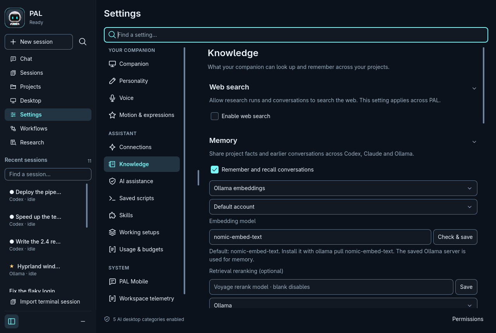
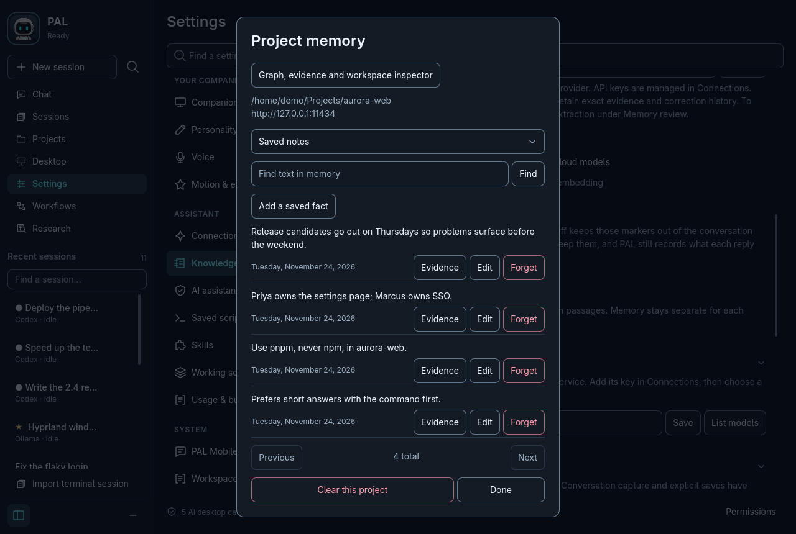

# Shared project memory

Graph memory is integrated into the broker and native inspector. **It remains experimental:** the full reference design’s release criteria have not all passed. See [implementation status](implementation-report.md) and [evaluation results](evaluation.md) for measured results and remaining work.

Enable **Settings → Knowledge → Memory → Remember and recall conversations**. Memory starts disabled. The default extraction model is **`glm-5.3-flash:cloud`**, an Ollama Cloud model; Settings can select another. Its evaluation is in [the memory evaluation](evaluation.md#extraction-through-canonical-memory-ev-01). Ollama embeddings default to **`nomic-embed-text`** and require a local model registered with the configured server. PAL does not download these models automatically. Selecting a hosted embedding provider and enabling cloud embedding separately allows PAL to send eligible document text and search queries to it. Local-only passages are excluded. Cloud extraction and sharing recalled memory with a cloud chat model have independent controls. Cloud recall starts disabled, and local-only sources are excluded from cloud extraction.

Managed conversations share the same memories for the same project and memory server, whichever provider they use. Codex and Claude use the Ollama server selected in **Connections** for embeddings; existing Ollama conversations retain their saved server. Enable **Share recalled memory with Codex, Claude and cloud models** to supply recalled context to Codex, Claude, AntiGravity, API providers and cloud models. Before a turn whose message names a topic, PAL supplies bounded context when relevant memories are found. It records completed replies with their source roles. Native providers also receive the shared memory tools through PAL's session-scoped MCP connection. Standalone CLI sessions outside PAL do not automatically receive this connection. Existing project/server scope keys are preserved; changing providers does not copy or migrate the data.

Canonical observations, exact source witnesses, entities, typed assertions, correction history, episodes, and erasure records live in private SQLite at `$XDG_STATE_HOME/pal/graph-memory/memory.sqlite`. Neo4j and Qdrant, or another vector store you configure, are rebuildable projections. Their pointers are checked against canonical scope, time, revision, policy, and erasure state before text is recalled. See [operations](operations.md) for authenticated dependency setup, Fish integration, backup, restoration, and reindexing.

**Manage project memory** opens saved notes and conversation passages for the selected conversation’s project folder and Ollama server. The **Graph, evidence and workspace inspector** adds temporal queries, provenance, structured corrections, conflicts, collector policy, indexing status, and forgetting progress. Structured corrections require an exact source quotation and the inspected revision. Uncertain effective dates remain candidates for review. Identity decisions are reversible: “same” makes recall treat two entities as one, “not the same” keeps them apart even when other links would join them, and “possible” is only a note for review. Records are never rewritten, so reverting a decision splits the entities again. Choose the project task a conversation works on, and what is said there comes first in its memory. Model text alone cannot establish that an action succeeded.

**Review.** In **Settings → Knowledge**, select a review model, inspect its recommendations and choose which supporting excerpts PAL may retain. The review inbox can forecast expiry and protect existing memories. Review starts off. [Setup and backlog preservation](operations.md#desktop-016-rollout-and-backlog-preservation)

<table>
<tr>
<td width="50%" valign="top"> <b>Settings → Knowledge</b> with memory enabled.</td>
<td width="50%" valign="top"> Saved facts for a project in <b>Manage project memory</b>.</td>
</tr>
</table>

Replies that use recalled memory cite it inline as `[evidence:ID]`. These markers are hidden by default: conversations, completion and pinned-reply cards, Activity results, the completion inbox and command-palette snippets leave them out, and so do Copy, Quote, Branch and Speak. Turn on **Settings → Knowledge → Memory → Show memory citations in replies** to see them. Saved replies keep every marker, so the record of which evidence each reply cited is unchanged, and spoken replies never read them aloud.

Writes commit before embedding, so saved decisions are available to lexical recall even while indexing is unavailable. Retrieval degrades with explicit coverage when a model or projection is down. Memory enters the prompt as delimited untrusted data, with separate records of evidence supplied to the model and evidence actually cited. Recent chat context still uses a bounded prompt window with complete tool request/result pairs. A reply waits at most eight seconds for memory, and the conversation shows **Recalling memory…** meanwhile. After that the reply goes ahead without recalled context and memory shows as degraded. Stop ends the wait at once.

Forgetting suppresses use immediately, scrubs matching passages from PAL’s managed conversation history, and reports physical deletion separately while projection acknowledgements are pending. A forget preview walks only records that are not yet erased, and it gives up after 30 seconds instead of holding memory. If a memory request runs far past its limit, PAL stops it and restarts memory while replies continue. Keep the current external erasure registry when restoring any backup; an older backup alone must not resurrect forgotten content. External provider histories and copies exported outside PAL are not managed by this workflow. Disabling memory stops normal capture and recall without deleting retained records.

Architecture, configuration boundaries, and pinned versions are documented in [architecture](architecture.md), [policy](policy.md), and [versions](versions.md).
