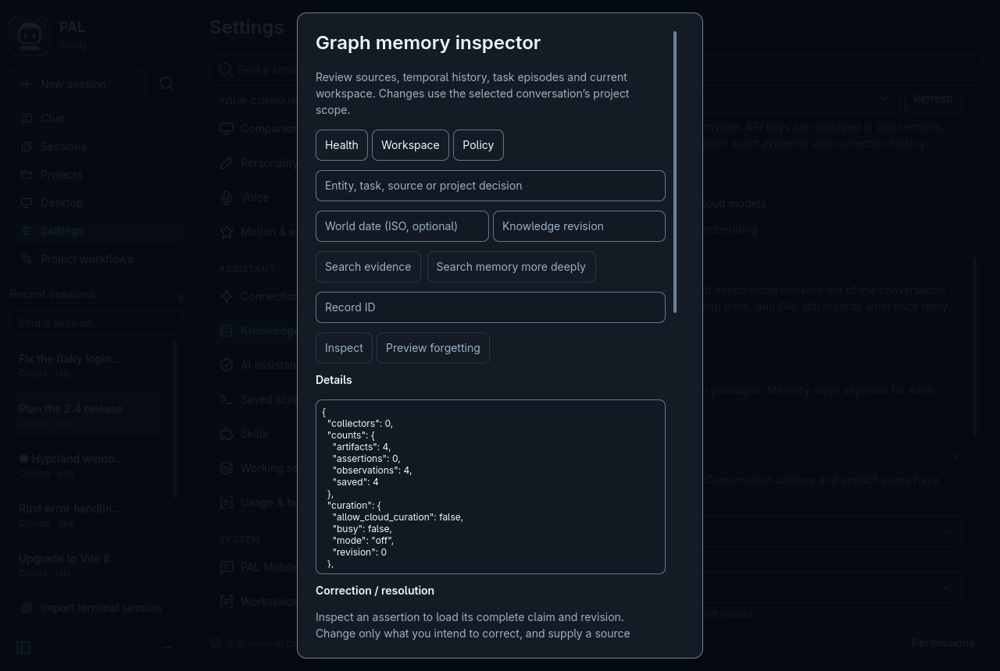

# Graph memory operations

Build and install PAL using the root README. From a source checkout, invoke `node broker/memory-cli.ts`; after installation use `pal memory`. The existing PAL broker hosts memory; there is no separate memory daemon to start. CLI operations do not auto-start an absent broker.

## Desktop 0.1.6 rollout and backlog preservation

1. Before upgrading an existing installation, run `pal memory health --json` and `pal memory backup --output /private/backups/pal-before-016.sqlite`. Use a fresh path. Keep the manifest and current erasure registry with the backup. Install the desktop update through the installation method used for that profile. Open PAL and run health again. Migrations 6 and 7 append tables and indexes and import active manual pins. A record that had more than one active pin keeps its oldest, with every distinct note, and the others are released. Existing TTLs, credentials, scope IDs, factual status and capture permissions carry forward. New curation starts Off.
2. Select a conversation in the project to inspect. In the chat toolbar or chat menu, open **Memory review → Expiring memories** for a scoped dry run. The individual inspector shows the candidate deadline, when supporting excerpts start expiring, when the last complete support would disappear and the effective deadline after protection. A later independent source may outlive the first. Dates and counts depend on the installation and change as new turns arrive.
3. In **Settings → Knowledge → Memory review**, choose a connection, then select a model from its dropdown. The list loads automatically. For an unlisted model, choose **Enter a model ID…**. Choose **Preview recommendations** for a trial. Save settings, then choose **Test model**. The probe uses synthetic input and consumes the configured request budget. A cloud probe requires saving cloud-curation consent first. To retain evidence while processing a backlog, choose **Assisted review**, authorize retaining supporting excerpts and explicitly enable review grace. These choices also authorize the periodic sweep of at-risk candidates.
4. In **Expiring memories**, inspect the page, enter a new private backup path and select **Back up and protect this page**. Save the returned backup, manifest, registry and hold IDs. Refresh before acting on the next page. A stale manifest requires a new preview. Use **Release hold** to reverse the selected hold. Manual pins have their own release action. Releasing a hold makes a record subject to its ordinary effective deadline again.
5. Choose **Review existing memory**, preview the selection and queue it. The broker processes one target at a time while idle. Use **Recommendations** to inspect the source and apply a recommendation, defer, correct, restrict to local processing, dismiss or forget. The inspector shows the reviewer, assessment and version history. A later correction or erasure can supersede a pending recommendation. **Undo decision** restores an eligible previous state through a new revision.
6. **Automatic** can preserve uncertain memories for the configured term. Enable automatic acceptance separately. A measured route needs independent held-out evidence. The experimental checkbox authorizes the tested unmeasured route and retains the same source and authority checks. Neither option converts an assistant's reported success or a plan into an observed outcome. Reranking and synthesis each have a separate switch. The chat model and embedding selection stay independent.
7. **Save retention policy** sets future baseline durations. To migrate existing deadlines in the selected project, use **Preview changes to existing project memory**. Review the additional retention and newly due counts, enter a new backup path, then explicitly apply. Continue the bounded batches until complete. **Undo retention policy change** restores surviving eligible deadlines. A record already forgotten or cleaned up requires the normal registry-aware recovery procedure.

The following shell session previews, protects and queues one scoped page. Set `SESSION` to the selected conversation ID and `BACKUP` to a new private filename. Run each mutation after inspecting the preceding JSON. Preview manifests are held by the running broker and must be regenerated after a restart or a relevant change.

```sh
pal memory curation status --session "$SESSION" --json
pal memory retention preview --session "$SESSION" --reason review_grace --limit 25 --json > forecast.json
jq '{counts,items,next_cursor}' forecast.json
jq --arg out "$BACKUP" '{selection,expected_revision:.revision,reason,output:$out}' forecast.json |
  pal memory retention protect --session "$SESSION" --stdin --json > protected.json
pal memory curation preview --session "$SESSION" --limit 25 --json > review.json
jq '{selection,ids:[.rows[].version_id],limit:25}' review.json |
  pal memory curation run --session "$SESSION" --stdin --json
pal memory curation list --session "$SESSION" --limit 10 --json
```

For a single memory, use `pal memory retention forecast --session "$SESSION" --id "$ID"`. Release a specific hold with `pal memory retention release --session "$SESSION" --hold-id "$HOLD"`. A policy change in progress can resume through `retention policy-apply --session "$SESSION" --change-id "$CHANGE"`. Review settings are global and use a separate revision. Read `pal memory curation settings` before calling `curation configure --file settings.json` with `{"expected_revision":<returned revision>,"profile":{...}}`. Each task binding has a connection reference and exact model ID. Ordered `fallbackBindings` contain complete bindings. A cloud fallback requires explicit authorization on that binding as well as cloud task consent. Compatible connections keep their own origin-bound keys. Private excerpts, context, evidence and neighbors require local processing throughout.

**Troubleshooting.** A blocked job includes an error code. For an unknown processing location, inspect the saved connection and its processing declaration. For a missing key, edit that connection. For invalid output or unsupported citations, inspect the original evidence or change models. Token or request exhaustion postpones work until the next UTC day. Each attempted provider request reserves its own allowance. Unknown provider usage retains its reservation. An unset price displays unknown cost. Foreground work interrupts background inference. Capture, lexical search, correction, explicit saves and forgetting are available independently of the reviewer.

**Rollback.** Switch curation Off. Use the running compatible broker to run `pal memory restore --input /private/backups/pal-before-016.sqlite --staging /private/empty-staging` while the current registry is available. Verify the staged store, including a previously forgotten ID. Stop the desktop and broker and preserve that registry and backups before switching directories. Earlier binaries require their supported schema. Use a matching pre-upgrade backup and the documented erasure-aware recovery workflow. Turning Off future assessments does not undo already accepted facts or release existing manual holds.

## API models (no Ollama required)

In **Settings → Connections**, add a Gemini API key and, if using Claude for extraction, a Claude API key. Memory reuses those credentials; keys are never stored in memory settings. `GEMINI_API_KEY` / `GOOGLE_API_KEY` and `ANTHROPIC_API_KEY` in the broker environment also work.

In **Settings → Knowledge → Memory**:

- Choose **Gemini API embeddings**, enable **Allow Gemini to embed memory and search queries**, and use **Check & save**. The initial embedding model is `gemini-embedding-001`; its ID can be changed.
- Choose **Gemini API** or **Claude API** as the extraction provider, then **Refresh** and select a model. Enable **Allow cloud memory extraction**. Extraction and embeddings are independent, so Claude extraction can use Gemini embeddings.
- Enable **Share recalled memory with Codex, Claude and cloud models** when those chat providers should receive recalled memories. This permission is separate from background extraction and embedding consent.

API processing is billed by the provider. Local-only sources are excluded from cloud extraction and all embedding queues; keyword recall remains available. Switching embedding providers/models preserves existing memories and uses a separate vector space that fills in the background. Project/server scope identifiers stay unchanged, so switching providers does not move or hide memories. With both jobs on APIs, the saved Ollama address remains a scope identifier and is not contacted for those jobs. Neo4j/Qdrant remain optional local projections as before.

API provenance records the returned model version when supplied and a hash of its provider/model identity, not a model-weight digest. Embedding identity uses the configured model ID; a vendor silently changing that ID's weights cannot be detected. Prefer versioned model IDs where offered. Requests use the [Gemini content and embedding APIs](https://ai.google.dev/api) and [Claude Messages API](https://platform.claude.com/docs/en/api/messages/create).

## Local dependencies

The source deployment profile is `packaging/memory-compose.yml`. Installed files are under the installation prefix's `share/pal/packaging` and `share/pal/tools`; memory documentation is under `share/doc/pal/memory`.

Create a private environment file outside the repository from `packaging/memory.env.example`, replace both placeholders with independently generated secrets, and set mode 0600. Point `PAL_MEMORY_ENV_FILE` to that file. `tools/memory-dependencies.sh up` starts the pinned authenticated containers using Docker Compose or Podman Compose. Published ports bind only to loopback.

Without containers, set `PAL_MEMORY_DEPS_HOME` to a private dependency directory, then run:

```sh
tools/memory-dependencies.sh local-install
tools/memory-dependencies.sh local-start
tools/memory-dependencies.sh check
```

The native path requires curl, tar, SHA-256 utilities, and compatible Java. It downloads checksum-locked Neo4j/Qdrant binaries. `check` uses an isolated synthetic dataset and stops/restarts these services; run it against disposable validation dependencies, not a shared production database. Use `down` for Compose or `local-stop` for native dependencies.

The broker needs the same secrets in a private JSON file whose keys are `graph` (Neo4j password) and `qdrant` (Qdrant API key). Set `PAL_MEMORY_CREDENTIALS_FILE` to its absolute path and keep mode 0600. This is separate from the shell environment file used by the launcher. Broker endpoint overrides are `PAL_NEO4J_URI`, `PAL_NEO4J_USER`, and `PAL_QDRANT_URL`; defaults are `bolt://127.0.0.1:7687`, `neo4j`, and `http://127.0.0.1:6333`.

For an installed broker, add the credential-file path through a `systemctl --user edit pal-broker` service environment override. A service restart interrupts active conversations; schedule it when idle. Do not put the passwords themselves into command-line arguments or the repository.

## Inspection and recovery

```sh
pal memory health
pal memory doctor
pal memory query --session SESSION_ID --text "project formatting"
pal memory inspect --session SESSION_ID --id RECORD_ID
pal memory forget-preview --session SESSION_ID --id RECORD_ID
pal memory erasure-status --job JOB_ID
pal memory rebuild --backend graph --dry-run
pal memory rebuild --backend graph
pal memory rebuild --backend vector
pal memory compact --output /private/path/before-compaction.sqlite
pal memory readjudicate --dry-run
pal memory readjudicate --output /private/path/before-readjudication.sqlite
```

Structured commands (`remember`, `correct`, `resolve-conflict`, `identity`, `policy-update`, and `forget`) accept `--file request.json` or `--stdin`. The session selects the authorized project scope. Corrections require a current slot revision and an exact quote from an existing observation. The inspector exposes the same operations. `health` shows canonical/projection revisions, queues, erasure epochs, and memory counts. Backend failures leave canonical writes available and display degraded coverage; suppression is immediate, but a purge cannot complete while its required backend is unavailable.



Back up with `pal memory backup --output /private/path/memory.sqlite`. Preserve its manifest and the **current** `$XDG_STATE_HOME/pal/graph-memory/erasure-registry.jsonl` independently. The backup command covers graph memory, not the separate main `pal.sqlite` conversation/settings database.

Compact with `pal memory compact --output /private/path/before-compaction.sqlite`. In one step it writes a backup and its manifest to that new path, then removes what erasure left behind: tombstoned assertion versions, artifacts and payloads with their support and lineage rows, finished projection jobs, and change records of erased targets that every projection has passed. Tombstones, erasure jobs, commits, the erasure registry and all live records stay, so erased identifiers remain rejected. Compaction also drops the link between an erased claim and its source. Afterwards, forgetting an entity removes its current claims and their sources, but no longer the sources of claims that were already erased. Memory requests wait while it runs; replies continue without recalled context.

Re-adjudicate with `pal memory readjudicate --output /private/path/before-readjudication.sqlite` after the acceptance rule changes. In one step it writes a backup and its manifest to that new path, then decides every pending extraction candidate that has not expired as if it were proposed again with its stored claim and quotation: one the current rule admits is accepted, or disputed against a conflicting fact, and one it still holds is rejected and expires on the candidate schedule. No model is called. The reply lists each decision with the rule that held a rejected candidate; `--dry-run` reports the same decisions without writing or backing up.

Restore with `pal memory restore --input /private/path/memory.sqlite --staging /private/empty-directory`. It refuses the serving directory and a nonempty staging directory. The current registry is applied before staged queries or projection rebuilds. It does not switch the live profile automatically. Stop the broker before an operator-controlled replacement, preserve private modes and both databases, and retain the newest registry. Do not overwrite a newer registry with the backup's older copy. Projection rebuilds are staged and catch up before becoming active.

## Fish and desktop collectors

Enable the desired collector and approved roots in the graph inspector. Fish handlers can be sourced from the checkout's `broker/graph-memory/adapters/fish/pal-memory.fish` or the installed `share/pal/broker/graph-memory/adapters/fish/pal-memory.fish`. Add that explicit source command to your Fish configuration to enable it in new interactive shells. The adjacent Python emitter must remain executable. Remove the source command and restart shells to uninstall. Events fail quietly if the private socket is absent. `PAL_MEMORY_SOCKET` overrides the socket for isolated testing.

Hyprland uses the session's instance socket. To capture titles, turn on **Capture titles of approved applications** and list each application class (for example `kitty`) under the title applications in the inspector; titles of unlisted applications are discarded. Kitty requires an explicitly configured read-only Unix inspection endpoint via `PAL_KITTY_INSPECT_ENDPOINT`; `PAL_KITTY_INSTANCE_ID` supplies a stable configured instance label. PAL never enables broad Kitty remote control automatically. Live Kitty validation remains pending on this development machine. Do not interpret an unknown pane, CWD, or checkout mapping as verified context.

## Diagnostics and limits

A forget preview, and the source lookup that comes before an erasure, stop after 30 seconds; retention expiry stops after 60 seconds. Neither stops inside a transaction, so an erasure never commits partially. A request that runs past its watchdog limit ends the memory worker. The limit is one minute beyond the request's budget, ten minutes for an erasure or expiry that may be committing, and none for backup, restore, rebuild, compaction or re-adjudication. The open transaction rolls back, waiting requests fail, and a new worker starts after replaying any recorded erasure that never committed. `health` reports `maintenance_error` when a housekeeping tick stopped early, and `embedding_error` when background embedding failed; it tries again a minute later.

Logs should contain opaque IDs and error codes, not raw rejected source text or credentials. Development tests use temporary isolated state and runtime directories. Generated databases, logs, packages, dependency bundles, and snapshots are ignored by Git. The erasure registry itself contains opaque identifiers and is runtime state, not a repository deliverable.

See [implementation status](implementation-report.md) for incomplete workflows and [evaluation](evaluation.md) for failed or unmeasured release targets. A successful compilation does not establish those targets.

Validate a staged installation without touching user state using `python3 tools/check-memory-install.py --root build/publish-install/share/pal`. It uses a local Ollama fixture and unavailable projection endpoints; no cloud request is made. It checks the installed native helper, broker socket, CLI, saved-note recall, and forgetting while backends are down.
